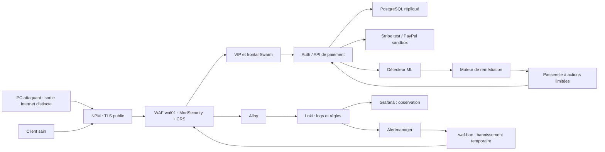

# Passation cybersécurité et gouvernance — RESILIENCE-ALPHA

**Destinataire : la personne qui reprend la partie de Rémi.** Ce dossier permet
d'expliquer, d'exploiter et de présenter cette partie sans relire les échanges
de travail. État documentaire au **22 octobre 2026**, sans nouvelle campagne
de charge ni nouveau déploiement lors de la rédaction.

## Lire dans cet ordre

1. Ce document : périmètre, composants et niveau de preuve.
2. [Exploitation et passation](EXPLOITATION.md) : accès, contrôles, incidents,
   organisation et travail restant.
3. [Présentation au jury](JURY.md) : discours prêt à adapter, démo et réponses.
4. [Guide Red Team](../redteam/README.md) : installation et commandes des tests.

## 1. Ce que couvre la partie cyber

Objectif : protéger l'entrée de la plateforme de paiement, rendre les événements
de sécurité observables, contenir une source hostile et apporter des preuves.
La gouvernance relie ces moyens techniques aux risques, à la continuité et aux
décisions humaines.

| Élément | Contribution de la partie cyber | Compléments et dépendances de l'équipe |
| --- | --- | --- |
| WAF dédié | Déploiement initial de `waf01`, nginx + ModSecurity + OWASP CRS, TLS interne, filtrage, pare-feu et journalisation | Déplacement en DMZ, publication via NPM, import Terraform et HA, adaptations applicatives documentés dans INFRA |
| Collecte et SOC | Raccordement des journaux WAF à Alloy/Loki, dashboard Cyber, règle `WAFRepeatedBlocks`, recette de corrélation | Socle VictoriaMetrics/Grafana/Alertmanager, intégration Ansible et notifications partagés avec l'infra |
| Confinement | Recette du bannissement et contrôle d'un client sain | Récepteur `waf-ban`, règles automatiques et routage apportés par l'infra |
| Red Team | Suite Python versionnée, périmètre explicite, tests SQL/XSS/SOC, stimulus borné, preuves et guide | PC attaquant à sortie distincte ; répétition avec les personnes IA, application et infra |
| Continuité et gouvernance | Préparation PCA/PRA, limites des recettes, traçabilité des incidents, critères de reprise métier | Dossier de gouvernance et preuves de restauration de l'équipe ; responsabilités et décisions à faire valider |
| IA et remédiation | Vérifier l'observabilité et les droits limités ; fournir le stimulus et les preuves | Modèle, moteur et passerelle développés dans les autres piliers : ne pas attribuer leur réalisation à la seule partie cyber |

Le WAF et les règles Loki sont déterministes. **Ce ne sont pas le détecteur ML.**
Le confinement d'une IP et la réparation de l'API sont deux mécanismes différents.

## 2. Architecture actuelle à connaître

Schéma fonctionnel simplifié. La chaîne détaillée des alertes et actions du
moteur est dans les documents IA/applicatifs et INFRA ; ne pas interpréter les
flèches comme l'inventaire exact des protocoles ou des ports.

- **Entrée des tests :** `https://app.slabreze.fr/`, port public 443.
- NPM transmet au WAF en HTTPS sur 8443 ; le WAF relaie vers la VIP applicative.
- L'adresse actuelle du WAF est `10.30.2.251`, en **RA-DMZ**. L'ancienne
  `10.0.1.251` figurant dans les comptes rendus du 20 octobre est historique.
- Le chemin VPN → DMZ n'est pas à ouvrir pour les tests. Le scénario
  « PC admin compromis » est une vérification de segmentation séparée.
- Le WAF n'a pas de console web d'administration dans cette réalisation.
  **Grafana sert à observer**, le SSH d'administration sert à configurer.

## 3. Ce que fait réellement le WAF

ModSecurity analyse les requêtes HTTP avec les règles OWASP CRS : des motifs
comme les injections SQL et le XSS peuvent entraîner un refus 403 avant que
la requête arrive à l'application. La configuration de départ est en blocage,
paranoïa 1 ; les valeurs effectives doivent être relues avant modification.

Il ne corrige pas les vulnérabilités du code, ne remplace pas les contrôles
d'authentification et ne protège pas contre toutes les attaques distribuées.
Un 403 peut aussi venir de l'application : consulter l'audit et son identifiant
de règle avant de conclure « attaque bloquée par ModSecurity ».

L'IP réelle est importante : dans la configuration décrite par INFRA, le WAF
fait confiance au transfert d'adresse de **NPM uniquement**. Un en-tête fourni
par un client ne doit pas lui permettre de choisir l'IP bannie. Les journaux
doivent confirmer la source effectivement vue avant le scénario SOC.

## 4. Journaux, dashboard et alertes

Alloy collecte les journaux système/conteneur et les envoie à Loki. Grafana
interroge Loki pour afficher accès WAF, codes HTTP, sources bloquées et audit
ModSecurity. Le dashboard Cyber a l'UID **`resilience-cyber`**.

Le socle utilise **VictoriaMetrics**, compatible avec l'écosystème Prometheus,
pour les métriques. Loki conserve les logs ; Grafana les présente. Ne pas dire
que Grafana collecte ou stocke seul tous ces événements.

| Règle | Condition dans la source INFRA consultée | Réponse |
| --- | --- | --- |
| `WAFRepeatedBlocks` | ≥ 10 réponses 403 par source en 1 min, maintenues 15 s | Alerte d'investigation, `remediation=manual` ; cette règle seule ne bannit pas |
| `WafSourceAttacks` | ≥ 10 réponses 403 par source en 2 min | `action=ban` vers le récepteur WAF |
| `WafSourceBruteForce` | ≥ 10 POST `/auth/login` ou `/auth/token` en 401/429 en 2 min | Bannissement temporaire |
| `WafSourceFlood` | **> 1200** requêtes par source en 1 min, hors `/healthz` | Bannissement temporaire |

Les règles de ban sont évaluées toutes les 15 s. Alertmanager groupe et route
les alertes ; `waf-ban` valide la demande, applique la liste nginx et journalise
la décision. Durée normale : **900 s / 15 min**, puis expiration automatique.
Les requêtes déjà bannies ont `event_type=waf_banned` et ne doivent pas entretenir
indéfiniment les règles basées sur `http_access`.

**Évolution à retenir :** le premier SOC du 20 octobre routait certaines alertes
vers `blackhole`, sans notification ni ban ajouté. L'intégration du 21 octobre
décrite par INFRA comporte le récepteur de ban et des notifications. Ne pas
présenter le compte rendu initial comme la configuration actuelle ; vérifier
les routes et récepteurs effectivement chargés avant de promettre une notification.

Les logs d'accès limitent les données enregistrées ; les audits peuvent contenir
des fragments associés à une règle. Utiliser des données fictives et limiter
l'accès aux preuves. Une empreinte SHA256 détecte une modification par rapport
à une empreinte de référence ; elle ne rend pas les logs immuables ou infalsifiables.

## 5. Résultats et limites de preuve

| Vérification | Résultat connu | Portée exacte |
| --- | --- | --- |
| WAF initial, 20/10 | normal 200, SQL/XSS 403, reprise après redémarrage VM | Recette initiale sur le laboratoire, avant migration en DMZ |
| Collecte et règle SOC, 20/10 | accès/audit dans Loki, dashboard, alerte firing puis résolue | Règle déterministe, pas verdict ML |
| Suite WAF/SOC, 21/10 | **38 contrôles sur 38**, ban journalisé, client sain accessible | Essai via relais interne ; l'IP vue est celle du relais |
| Paiements de sonde après le ban, 21/10 | nouveaux paiements de test réussis | Trajet interne de la sonde, pas preuve de paiement public par cette recette |
| Publication et paiement publics, 21/10 | Décrits comme vérifiés dans `infra/docs/waf.md` | Vérification de l'équipe infra ; distincte du clip complet et de notre recette par relais |
| Anciens stimuli ML | 102 lectures puis 100 demandes invalides authentifiées ; aucun verdict ML observé | Succès des attentes HTTP, **pas succès de la chaîne IA** |
| Nouveau trajet public, 22/10 | contrôle normal 200, TLS vérifié | Une requête normale ; pas une campagne d'attaque publique |
| Nouveau scénario `burst` | préparé et versionné ; 19 tests locaux réussis | **Charge non lancée**, conformément au choix de Rémi ; sortie séparée non disponible |
| Clip complet public | **à valider** | Attaque → verdict ML → action automatique → nouvelle transaction dans une prise continue ≤ 60 s |

Les délais d'environ 4 s de détection et 13,8 s de redémarrage cités dans la
documentation infra concernent une recette de charge interne. Ils ne sont pas
des engagements ni des résultats de notre scénario public `burst`.

## 6. Gouvernance et PCA/PRA

Le dossier de gouvernance est sur la
[branche gouvernance](https://github.com/Zouitni-Yassine/M2-EPSI-Workshop/tree/gouvernance/gouvernance).
Il contient cadre, BIA, analyse EBIOS RM, PCA/PRA, analyse réglementaire,
arbitrages et recommandations. **Le relire avec son auteur**, notamment les
hypothèses financières, références juridiques et points marqués « à vérifier ».
Ce guide ne constitue ni une validation juridique ni une attestation de conformité.

Les preuves techniques sont dans le
[PCA/PRA technique INFRA](https://github.com/Zouitni-Yassine/M2-EPSI-Workshop/blob/INFRA/infra/docs/pca-pra-technique.md).
Ne pas multiplier les versions contradictoires du plan : rapprocher les anciens
documents préparatoires de Rémi de ces sources actuelles avant le rendu final.

À expliquer :

- **PCA :** continuer le service malgré un incident, par redondance, filtrage,
  bascule et maintien d'un chemin de paiement sain.
- **PRA :** rétablir un service ou des données depuis un état fiable après un
  incident ; cela peut demander une décision et une restauration humaines.
- **RTO :** durée cible de reprise, à comparer à une indisponibilité métier
  effectivement mesurée ; le temps d'une commande de redémarrage n'est pas le RTO.
- **RPO :** perte de données acceptable en durée ; il dépend du scénario et
  de la dernière copie utilisable, pas du seul fait qu'une sauvegarde existe.
- Réplication ≠ sauvegarde : une suppression logique peut être répliquée.
  Il faut une copie antérieure exploitable et une restauration testée.
- Reprise de disponibilité ≠ éradication : après compromission, isolement,
  analyse, rotation des secrets et vérification d'intégrité restent nécessaires.

Le document INFRA décrit des dumps de base toutes les 15 min et des sauvegardes
PBS quotidiennes. Ce sont des fréquences documentées à contrôler dans les jobs
et preuves ; ne pas promettre un RPO global de 0 ou 15 min pour tous les sinistres.
Le site unique et la copie hors site des dumps doivent rester des sujets explicites.

## 7. Sources et remise

Sources lues pour cette passation : `main` **8ddf5fd**, INFRA **2272ebd**,
gouvernance **df63947**, ainsi que les recettes privées des 20–22 octobre.
Les branches continuent à évoluer ; une mesure plus récente doit être reliée
à son journal et à sa version, sans écraser l'historique.

- [WAF : architecture, ban et exploitation](https://github.com/Zouitni-Yassine/M2-EPSI-Workshop/blob/INFRA/infra/docs/waf.md)
- [Supervision](https://github.com/Zouitni-Yassine/M2-EPSI-Workshop/blob/INFRA/infra/docs/supervision.md)
- [Passerelle de remédiation](https://github.com/Zouitni-Yassine/M2-EPSI-Workshop/blob/INFRA/infra/docs/remediation.md)
- [Tests de résilience](https://github.com/Zouitni-Yassine/M2-EPSI-Workshop/blob/INFRA/infra/docs/tests-resilience.md)
- [Procédure de démo de l'équipe](https://github.com/Zouitni-Yassine/M2-EPSI-Workshop/blob/INFRA/infra/docs/demo.md)
- [Sources Red Team](../redteam/) ; intégration initiale : [PR nº 6 fusionnée](https://github.com/Zouitni-Yassine/M2-EPSI-Workshop/pull/6).

Dans le rendu : inclure `cyber/` et `redteam/` dans le **Code.zip global**, les
documents de gouvernance retenus dans le dossier et le clip effectivement validé.
Les preuves détaillées sont à transférer dans l'espace privé de l'équipe, jamais
avec des clés, mots de passe, cookies ou profils VPN dans le dépôt public.
