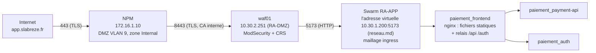

# Application Resilience Pay sur le Swarm

Portage de l'application des développeurs sur le cluster Swarm (20/10/2026), en quatre volets :
registre et build des images, stack et secrets, moteur de remédiation en mode SSH, exposition
publique. Réseau : [reseau.md](reseau.md) ; supervision de l'application : [supervision.md](supervision.md).

## Registre et build

Les images de l'application sont construites par Ansible à partir d'une révision figée du dépôt,
puis poussées dans un registre privé hébergé dans le Swarm. Un seul playbook fait les deux :

```bash
cd /srv/M2-EPSI-Workshop/infra/ansible
vault-env ansible-playbook app-build.yml                    # registre + 5 images
vault-env ansible-playbook app-build.yml --tags registry    # registre seul
vault-env ansible-playbook app-build.yml --tags build       # images seules
vault-env ansible-playbook app-build.yml --tags build -e '{"app_build_images": ["remediation"]}'
vault-env ansible-playbook app-build.yml --tags build -e app_git_ref=<sha complet>
vault-env ansible-playbook app-build.yml --tags build -e app_build_force=true   # tout reconstruire
```

Rôles : `app_registry` (stack du registre, confiance TLS, `docker login`) et `app_build`
(clone, construction, envoi).

### Registre

| | |
|---|---|
| Adresse | **`10.30.1.221:5000`** (variable `app_registry`, `roles/app_registry/defaults/main.yml`) |
| Stack / service | `registry` / `registry_registry`, image `registry:2.8.3` |
| Nœud | `dockerwrk01`, épinglé par contrainte de placement (`app_registry_node`) |
| Données | volume local `registry_registry-data` sur dockerwrk01 |
| TLS | certificat émis par la CA interne (rôle `internal_ca`, `issue.yml`) ; SAN : `dockerwrk01`, `dockerwrk01.epsi.lsn`, `10.30.1.221`, `127.0.0.1` ; installé dans `/etc/registry/tls` du nœud et monté en lecture seule |
| Authentification | Basic, htpasswd bcrypt en secret Swarm `registry_htpasswd_<empreinte>` |
| Identifiants | Vault `secret/infra/registry` : `REGISTRY_USERNAME`, `REGISTRY_PASSWORD` (exportés par `vault-env`) |
| Santé, métriques | port de debug `5001` non publié : `/debug/health` (healthcheck), `/metrics` (Prometheus), joignable sur le réseau overlay `monitoring` |

**Pourquoi un seul nœud.** `registry:2` stocke ses couches sur disque ; sans stockage partagé
(S3, NFS), deux réplicas auraient deux contenus différents. Le service est donc épinglé sur
dockerwrk01 avec un volume local, et publie son port en **mode host** : l'adresse du registre
est celle de ce nœud, la même que dans le certificat et dans le nom des images.
**Limite** : si dockerwrk01 tombe, le registre est indisponible. Les services déjà déployés
continuent de tourner (images en cache sur chaque worker), mais un nouveau placement sur un
worker qui n'a pas encore l'image échoue jusqu'au retour du nœud (la VM est en HA Proxmox,
elle redémarre seule sur un autre hyperviseur, disque sur Ceph : les données sont conservées).
Le volume n'est pas sauvegardé : les images se reconstruisent à l'identique par ce playbook.
Évolution possible : stockage S3 du registre (bucket dédié du tenant) et plusieurs réplicas
derrière l'ingress.

**Accès réseau.** Un port publié par un service Swarm passe par la chaîne FORWARD et contourne
le firewall de l'hôte (`host_fw`, hook input). Le port 5000 n'est donc filtré que par la
passerelle UniFi : seuls RA-APP (les nœuds du Swarm) et MANAGEMENT (poste de contrôle) le
joignent. C'est acceptable : il est en plus protégé par TLS et par mot de passe.

**Confiance et identifiants des nœuds.** Tous les nœuds ont la CA interne dans le magasin
système (rôle `internal_ca`) et, explicitement pour Docker, dans
`/etc/docker/certs.d/10.30.1.221:5000/ca.crt`. Seuls les **managers** sont connectés au
registre (`docker login`, `/root/.docker/config.json`) : le déploiement se fait par
`docker stack deploy --with-registry-auth` (ou `with_registry_auth: true` du module
`docker_stack`), et Swarm transmet ces identifiants aux workers le temps du téléchargement.
Aucun mot de passe n'est stocké sur les workers.

**Rotation du mot de passe.**

```bash
python3 roles/app_registry/files/registry-credentials.py --rotate   # nouveau mot de passe dans Vault
vault-env ansible-playbook app-build.yml --tags registry
```

Le nom du secret htpasswd porte une empreinte des identifiants : la rotation crée un nouveau
secret, met à jour le service, refait `docker login` sur les managers et supprime l'ancien
secret. Redéployer ensuite les stacks applicatives avec `--with-registry-auth` pour que Swarm
transmette les nouveaux identifiants. Le certificat (1 an) est renouvelé par le rôle
`internal_ca` ; un nouveau certificat redémarre le registre (handler).

### Build

- **Où** : sur `dockermgr01` (le poste de contrôle est un LXC sans Docker). Dossier de travail
  `/var/lib/app-build/src`, clone du dépôt public `Zouitni-Yassine/M2-EPSI-Workshop`.
- **Quelle révision** : `app_git_ref`, un commit complet (une branche est refusée : une même
  commande doit toujours produire les mêmes images). Par défaut le commit courant de
  `/srv/M2-EPSI-Workshop` sur le poste de contrôle, qui **doit avoir été poussé** sur GitHub.
- **Quoi** : les services de `app_build_images` (par défaut `auth`, `payment-api`, `detector`,
  `remediation`, `frontend`). Nom, version, contexte et build args sont lus dans le
  `docker-compose.yml` de la racine, à la même révision : une nouvelle version dans le compose
  donne automatiquement un nouveau tag.
- **Tags** : pour chaque image, deux tags dans `10.30.1.221:5000/<nom>` :
  - `<version>-<commit court>` : **figé**, jamais réécrit, à utiliser pour un retour arrière
    précis ; pour le frontend, suivi d'une empreinte de ses build args
    (`0.2.0-17985c9-85dcfad5`), car l'image dépend de la clé Stripe ;
  - `<version>` : le tag du `docker-compose.yml` (`auth:0.3.0`…), recopié côté registre
    (`docker buildx imagetools create`) sur la dernière construction. Avec
    `REGISTRY=10.30.1.221:5000`, le compose de la racine désigne donc directement ces images.
- **Idempotence** : une image dont le tag figé existe déjà dans le registre n'est pas
  reconstruite ; le tag `<version>` n'est recopié que s'il ne pointe pas sur le même manifeste.
  Second passage : `changed=0`. `app_build_force=true` force la reconstruction.
- **Labels** des images : `org.opencontainers.image.revision` (commit complet), `.source`, `.version`.

**Frontend et clés de paiement.** Les build args `${VAR}` du compose prennent leur valeur dans
`app_build_arg_values` : `VITE_STRIPE_PUBLISHABLE_KEY` et `PAYPAL_CLIENT_ID` lus dans Vault
`secret/infra/paiement` (via `vault-env`), `VITE_CARD_ENTRY=own`. Ils sont passés par
l'environnement de `docker build` (`--build-arg NOM` sans valeur) : rien dans la ligne de commande
ni dans la sortie d'Ansible. **Sans clé Stripe**, le frontend est construit quand même : le
paiement par carte est alors simulé localement, avec une bannière à l'écran
(`frontend/src/payments/engine/index.ts`). Dès que la clé est rangée dans Vault, relancer :

```bash
vault-env ansible-playbook app-build.yml --tags build -e '{"app_build_images": ["frontend"]}'
```

L'empreinte des build args change, donc le tag figé aussi : le frontend est reconstruit et
`frontend:0.2.0` est déplacé sur la nouvelle image (redéployer la stack ensuite).

**Code modifié non encore poussé.** Le build part toujours de GitHub : pour construire une
modification (par exemple `remediation/`), la pousser sur la branche, mettre à jour le poste de
contrôle, puis relancer le build de cette seule image.

### Vérifications

```bash
# 401 sans identifiants, catalogue avec (identifiants lus par vault-env, jamais affichés)
curl -s -o /dev/null -w '%{http_code}\n' https://10.30.1.221:5000/v2/_catalog          # 401
vault-env sh -c 'curl -s -u "$REGISTRY_USERNAME:$REGISTRY_PASSWORD" https://10.30.1.221:5000/v2/_catalog'
# {"repositories":["auth","detector","frontend","payment-api","remediation"]}
```

Faites le 20/10/2026 : 401 sans authentification ; catalogue des 5 images avec leurs deux tags ;
`docker pull 10.30.1.221:5000/payment-api:0.4.0` depuis dockerwrk02 (label `revision` =
commit attendu) ; second passage du playbook à `changed=0`.

Le ménage des anciens tags n'est pas automatisé (API `DELETE` activée, puis
`registry garbage-collect` dans le conteneur) ; le cache de build de dockermgr01 se purge par
`docker builder prune`.

## Stack et secrets de l'application

L'application « Resilience Pay » (code à la racine du dépôt) tourne sur le Swarm dans la stack
**`paiement`**. Elle est déployée par Ansible à partir d'un template dérivé de
`docker-compose.yml` ; ses secrets sont générés dans Vault puis montés en secrets Swarm.

| Fichier | Rôle |
|---|---|
| `infra/app/paiement-stack.yml.j2` | Template de la stack (dérivé de `docker-compose.yml`) |
| `infra/app/init-secrets-vault.py` | Génère les secrets de l'application dans Vault (idempotent) |
| `infra/ansible/roles/app_stack/` | Secrets et configs Swarm, rendu du template, `docker stack deploy` |
| `infra/ansible/app-deploy.yml` | Playbook : contrôles préalables puis rôle `app_stack` sur `swarm_managers[0]` |

### Architecture des services

| Service Swarm | Image | Réseaux | Exposition | Réplicas, redémarrage |
|---|---|---|---|---|
| `paiement_frontend` | `<registre>/frontend` (nginx : SPA + relais) | resilience | **port 5173** (ingress, tous les nœuds) | 1, any |
| `paiement_auth` | `<registre>/auth` | resilience, data, **monitoring** | aucun (relais `/auth/`) ; `/metrics` :8300 | 1 (freinage force brute en mémoire), any |
| `paiement_payment-api` | `<registre>/payment-api` | resilience, data, **monitoring** | aucun (relais `/api/`) ; `/metrics` :8000 | 1, **on-failure** |
| `paiement_detector` | `<registre>/detector` | resilience | aucun (relais `/detector/score`, opérateurs) | 1 (modèle en mémoire), any |
| `paiement_remediation` | `<registre>/remediation` | resilience | aucun (relais `/remediation/state`, opérateurs) | 1 (un seul décideur), any |
| `paiement_db1..3`, `paiement_etcd1..3` | `<registre>/paiement-postgres` (PostgreSQL 16 + Patroni), `quay.io/coreos/etcd` | data, dcs (internes), monitoring | aucun | 1 par worker, bascule automatique (voir « Base de données haute disponibilité ») |
| `paiement_mailpit` | `axllent/mailpit:v1.20` | resilience | aucun (non publié sur le cluster) | 1, any |

- Réseaux overlay de la stack **chiffrés** (IPsec, ESP autorisé par le firewall des nœuds) :
  `resilience` (relais et services) et `data` (`internal: true`, sans accès sortant : base).
  `monitoring` est le réseau externe de la stack de supervision : seuls `auth` et
  `payment-api` y sont attachés, pour la collecte de leurs `/metrics` par le vmagent du Swarm.
- Tous les services sur les workers (`node.role == worker`, managers drainés), répartis par
  hyperviseur (`spread: node.labels.pve_node`). Durcissement repris du compose : `read_only`,
  `cap_drop: [ALL]` (+ capacités minimales pour postgres et nginx), tmpfs, utilisateurs non root
  des images. Limites CPU/mémoire, healthchecks (ceux des images, celui de la base dans la
  stack) et `update_config` (start-first, rollback automatique) identiques au compose.
- **Différences avec `docker-compose.yml`** : images du registre privé à tag figé
  (`<version>-<commit court>`, produit par `app-build.yml`) ; pas de `build`, `container_name`,
  `security_opt`, `env_file` (variables explicites dans la stack) ; **pas de
  `docker-socket-proxy`** (contrat : jamais le socket Docker) ; `payment-api` en
  `restart_policy: on-failure` (un crash est relancé par Swarm, un arrêt volontaire, code 0,
  est laissé au moteur de remédiation) ; Mailpit non publié ; base PostgreSQL répliquée (Patroni).
- **Moteur de remédiation en mode SSH** : il agit par la passerelle `remediate` des managers
  ([remediation.md](remediation.md)) : `REMEDIATION_MODE=ssh`,
  `REMEDIATION_GATEWAYS=10.30.1.211,10.30.1.212,10.30.1.213` (construit depuis l'inventaire),
  `REMEDIATION_SSH_USER=remediation`, `REMEDIATION_SSH_KEY_FILE=/run/secrets/remediation_ssh_key`
  (secret externe `remediation_ssh_key`, propriétaire uid 10003, mode 0400),
  `REMEDIATION_KNOWN_HOSTS_FILE=/run/configs/remediation_known_hosts` (config externe),
  `TARGETS=paiement_payment-api`. La stack `paiement` figure dans `remediation_allowed_stacks`.
- `APP_URL` / `CORS_ORIGINS` : variable `app_url` (par défaut `http://10.30.1.221:5173`,
  accès direct à un worker). Quand le WAF publiera `https://app.slabreze.fr` :
  `-e app_url=https://app.slabreze.fr` (ou modifier le défaut) ; le cookie de session passe
  alors automatiquement en `Secure`.

### Secrets

Aucune valeur dans le dépôt, dans le fichier de stack ou dans la spec des services : les
secrets Swarm sont montés en fichiers sous `/run/secrets/<nom attendu par le code>`.

| Chemin Vault | Clés | Origine |
|---|---|---|
| `secret/infra/paiement-app` | `PAIEMENT_POSTGRES_PASSWORD`, `PAIEMENT_AUTH_DB_PASSWORD`, `PAIEMENT_PAYMENTS_DB_PASSWORD`, `PAIEMENT_JWT_PRIVATE_KEY` (PEM Ed25519), `PAIEMENT_DETECTOR_ADMIN_TOKEN`, `PAIEMENT_AUTH_PASSWORD_OPERATEUR`, `PAIEMENT_AUTH_PASSWORD_CLIENT` | Générées par `init-secrets-vault.py` (32 caractères aléatoires) |
| `secret/infra/paiement` | `STRIPE_SECRET_KEY`, `VITE_STRIPE_PUBLISHABLE_KEY`, `PAYPAL_CLIENT_ID`, `PAYPAL_CLIENT_SECRET` (facultatifs) | Saisies par l'utilisateur |
| `secret/infra/registry` | `REGISTRY_USERNAME`, `REGISTRY_PASSWORD` | Rôle `app_registry` |

| Secret de la stack (`/run/secrets/…`) | Clé Vault | Services |
|---|---|---|
| `postgres_password` | `PAIEMENT_POSTGRES_PASSWORD` | db (`POSTGRES_PASSWORD_FILE`) |
| `auth_db_password` | `PAIEMENT_AUTH_DB_PASSWORD` | db (init), auth (`DB_PASSWORD_FILE`) |
| `payments_db_password` | `PAIEMENT_PAYMENTS_DB_PASSWORD` | db (init), payment-api (`DB_PASSWORD_FILE`) |
| `jwt_private_key` | `PAIEMENT_JWT_PRIVATE_KEY` | auth (`JWT_PRIVATE_KEY_FILE`) |
| `auth_password_operateur`, `auth_password_client` | `PAIEMENT_AUTH_PASSWORD_*` | auth (`AUTH_PASSWORD_<COMPTE>_FILE`, comptes semés `AUTH_SEED_USERS`) |
| `detector_admin_token` | `PAIEMENT_DETECTOR_ADMIN_TOKEN` | detector (*) |
| `stripe_secret_key` | `STRIPE_SECRET_KEY` | payment-api (*) ; absent = pas de secret |
| `paypal_client_secret` | `PAYPAL_CLIENT_SECRET` | payment-api (`PAYPAL_CLIENT_SECRET_FILE`) ; facultatif |
| `remediation_ssh_key` (externe) | — (rôle `remediation_gateway`) | remediation |

(*) Variables sans variante `_FILE` dans le code : la commande du service est surchargée par
`sh -c 'export VAR="$(cat /run/secrets/x)"; exec uvicorn …'` (commande d'origine des
Dockerfile), la valeur n'apparaît donc ni dans la spec ni dans `docker service inspect`.

- **Noms versionnés** : `paiement_<secret>_<empreinte>` (SHA-256 salé et tronqué à 12
  caractères), label `com.epsi.usage=paiement` ; la config `paiement_db_init_<empreinte>`
  porte `db/init/01-roles.sh`. Une nouvelle valeur dans Vault crée un nouveau secret et met à
  jour les services concernés ; les anciens sont supprimés en fin de rôle (au passage suivant
  s'ils étaient encore utilisés).
- **Rotation des mots de passe de la base** : ils ne servent qu'à l'initialisation du volume.
  En changer dans Vault exige aussi `ALTER ROLE … PASSWORD` dans la base (ou la recréation du
  volume) ; sinon auth et payment-api ne se connectent plus. Les mots de passe des comptes
  semés et la clé JWT se changent librement (la rotation de la clé déconnecte les sessions).

### Commandes

```sh
cd /srv/M2-EPSI-Workshop/infra/ansible
python3 ../app/init-secrets-vault.py          # secrets générés (une fois ; n'écrase jamais)
vault-env ansible-playbook app-build.yml      # registre + images (agent A, docs/application.md)
vault-env ansible-playbook app-deploy.yml     # stack paiement
# Sans clé Stripe dans Vault (frontal en paiement simulé) :
vault-env ansible-playbook app-deploy.yml -e app_require_stripe=false
# Révision d'images différente du commit courant :
vault-env ansible-playbook app-deploy.yml -e app_git_ref=<sha>
```

Contrôles préalables du playbook (message explicite en cas d'échec) : secrets générés
présents (≥ 16 caractères, PEM pour la clé JWT), `STRIPE_SECRET_KEY` présente
(sauf `app_require_stripe=false`), identifiants du registre, et présence de chaque image au tag
attendu dans le registre (`/v2/<image>/tags/list`).

Le moteur de remédiation ne peut agir sur `paiement` qu'après le passage du rôle
`remediation_gateway` avec `remediation_allowed_stacks: [demo, paiement]` (`swarm.yml`).

### Vérifications

```sh
M="ssh -i /root/.ssh/id_ed25519_infra debian@10.30.1.211"
$M sudo docker stack services paiement                      # toutes les réplicas 1/1
curl -s -o /dev/null -w '%{http_code}\n' http://10.30.1.221:5173/            # 200
curl -s -o /dev/null -w '%{http_code}\n' http://10.30.1.221:5173/api/health  # 200 via le relais
# Connexion d'un compte semé, sans afficher le mot de passe (code HTTP seulement) :
vault-env sh -c 'printf "{\"username\":\"client\",\"password\":\"%s\"}" "$PAIEMENT_AUTH_PASSWORD_CLIENT" |
  curl -s -o /dev/null -w "%{http_code}\n" -H "Content-Type: application/json" -d @- \
  http://10.30.1.221:5173/auth/login'                                         # 200
vault-env ansible-playbook app-deploy.yml                   # second passage : changed=0
```

### Limites

- **Base** : répliquée sur les trois workers avec bascule automatique depuis le 21/10/2026
  (section « Base de données haute disponibilité », limites restantes en fin de section).
- **Réplicas uniques** (auth, payment-api, detector, remediation) : choix de l'application
  (état en mémoire), un redémarrage provoque une courte coupure. C'est aussi ce qui rend la
  démonstration de remédiation visible.
- **Port 5173 publié en mode ingress** : ouvert sur tous les nœuds et hors du firewall nftables
  des hôtes (un port publié par Swarm le contourne). À filtrer en amont (passerelle UniFi /
  WAF) : seul le WAF devrait joindre ce port une fois `app.slabreze.fr` en place.
- **Mailpit non publié** : les e-mails de réinitialisation ne sont pas lisibles de l'extérieur
  (volontaire : l'attaquant partage le réseau de démo). Pour une démo, lire via
  `docker exec` dans le conteneur ou publier temporairement le port avec un filtrage amont.
- Les clés Stripe/PayPal publiques sont intégrées **à la construction** du frontend
  (`VITE_*`, app-build.yml) : les changer impose de reconstruire l'image `frontend`.

## Base de données haute disponibilité (PostgreSQL + Patroni)

Depuis le 21/10/2026, la base de l'application n'est plus une instance unique épinglée sur
dockerwrk01 (perte de ce worker le 21/10 : 92 s sans paiement, le temps que la HA Proxmox
relance la VM) mais un cluster **Patroni** à trois membres, un par worker et donc par
hyperviseur, avec bascule automatique.

### Choix

| Piste | Verdict |
|---|---|
| `bitnami/postgresql-repmgr` | Écartée : retirée de Docker Hub (catalogue déplacé en 2025), seule `bitnamilegacy/` reste, figée depuis août 2025 (plus de correctifs) ; pas de verrou distribué (risque de double primaire au retour de l'ancien primaire) |
| **Patroni + etcd** (retenue) | Standard de fait ; verrou du primaire à durée de vie dans etcd (jamais deux primaires) ; réplication synchrone par quorum ; `pg_rewind` automatique au retour de l'ancien primaire ; métriques Prometheus natives. Paquets PGDG maintenus (Patroni 4.1.5) sur l'image officielle `postgres:16.15-bookworm` |
| Proxy (HAProxy, PgBouncer) devant la base | Inutile : libpq (psycopg 3, SQLAlchemy) accepte plusieurs hôtes et ne garde que celui qui accepte les écritures (`target_session_attrs=read-write`). Aucune modification du code applicatif ni des images construites depuis GitHub |

### Topologie

| Service Swarm | Image | Nœud | Rôle |
|---|---|---|---|
| `paiement_db1` / `db2` / `db3` | `<registre>/paiement-postgres:<empreinte>` (PostgreSQL 16.15 + Patroni 4.1.5) | dockerwrk01 / 02 / 03 (`node.hostname`) | un membre Patroni, volume local `paiement_pg-data` |
| `paiement_etcd1` / `2` / `3` | `quay.io/coreos/etcd:v3.6.15` | dockerwrk01 / 02 / 03 | verrou du primaire (quorum 2 sur 3), volume local `paiement_etcd-data` |

- **Image** : `infra/app/postgres-ha/` (Dockerfile, `entrypoint.sh`, `pctl`). Construite sur le
  manager par le rôle `app_stack` (comme la sonde : tag = empreinte des sources, reconstruite
  seulement si elles changent), poussée dans le registre privé, pré-téléchargée sur les
  workers avec l'image etcd par `app-deploy.yml`.
- **Configuration** : `infra/app/postgres-ha/patroni.yml.j2`, rendue en config Swarm versionnée
  `paiement_patroni_<empreinte>`. Valeurs du cluster (écrites dans etcd au premier démarrage
  seulement, ensuite `pctl edit-config`) : `ttl 20`, `loop_wait 5`, `retry_timeout 5`,
  `synchronous_mode: quorum` (un COMMIT attend au moins un des deux standbys ; seul un standby
  à jour est promu), `maximum_lag_on_failover` 1 Mo, `failsafe_mode` (etcd perdu : le primaire
  reste primaire s'il joint les autres membres), `use_pg_rewind`, slots de réplication,
  `wal_sender_timeout`/`wal_receiver_timeout` 10 s, sommes de contrôle des pages.
- **Initialisation** : le `post_bootstrap` de Patroni exécute `db/init/01-roles.sh` (même
  script que la base unique : rôles et bases `auth` et `payments`).
- **Durcissement** : utilisateur `postgres` de l'image, `read_only`, `cap_drop: [ALL]` sans
  aucune capacité ajoutée (le volume hérite du propriétaire du dossier de l'image), tmpfs.
  `pg_hba` : socket local sans mot de passe (sauvegardes, exploitation par `docker exec`),
  réseau en SCRAM depuis les réseaux overlay seulement.
- **Réseaux** : `data` (clients et réplication), `dcs` (nouveau, interne et chiffré : etcd et
  membres Patroni seulement), `monitoring` (`/metrics` de Patroni, port 8008). Membres et etcd
  en `endpoint_mode: dnsrr` : le nom d'un membre arrêté disparaît du DNS, pas d'adresse
  virtuelle IPVS devant des connexions longues.
- **Clients** (auth, payment-api) : `DATABASE_URL` =
  `postgresql+psycopg://<rôle>@/<base>?host=db1:5432&host=db2:5432&host=db3:5432&target_session_attrs=read-write&tcp_user_timeout=5000&keepalives_idle=5&keepalives_interval=2&keepalives_count=3`
  (variable `app_db_url_options`). Les options TCP font échouer en quelques secondes une
  connexion vers une VM disparue (sinon : plusieurs minutes de retransmissions).
- **Secrets** (modèle habituel : Vault → secrets Swarm versionnés, aucune valeur dans la spec) :
  `postgres_password` (superutilisateur), `replication_password` (rôle `replicator`,
  `PAIEMENT_REPLICATION_PASSWORD`), `patroni_api_password` (API REST de Patroni : bascule,
  redémarrage ; `PAIEMENT_PATRONI_API_PASSWORD`). Les deux nouvelles clés sont générées par
  `init-secrets-vault.py` dans `secret/infra/paiement-app`. Patroni ne lit pas de fichiers de
  secrets : l'entrypoint les exporte pour son seul processus.
- **Repère** : label de conteneur `com.epsi.db=paiement` sur chaque membre (sauvegarde,
  `chaos.sh`, `demo-check.sh`) ; le primaire est le membre hors recouvrement.

### Bascule et retour de l'ancien primaire

1. Le primaire disparaît (VM coupée, conteneur tué) : son verrou dans etcd n'est plus
   renouvelé et expire au bout de 20 s au plus.
2. Les standbys comparent leur position ; le standby synchrone le plus avancé prend le verrou
   et se promeut (nouvelle timeline). En quorum, il a forcément reçu toute transaction validée.
3. Les clients, à leur connexion suivante, essaient db1, db2, db3 et ne gardent que le nouveau
   primaire ; le standby restant suit le nouveau primaire.
4. L'ancien primaire revient (HA Proxmox, Swarm) : il voit le verrou tenu par un autre, se
   remet au niveau par `pg_rewind` (reconstruction complète si cela échoue) et redémarre en
   **standby**. Pas de double primaire possible : un membre sans verrou ne s'écrit jamais
   primaire.
5. Conteneur du primaire tué mais nœud vivant : Swarm le relance en ~5 s ; il retrouve son
   verrou encore valide et redevient primaire.

### Mesures

| Test | Panne | Résultat |
|---|---|---|
| Prototype (stack `dbtest`, client écrivant toutes les 200 ms) | `kill -9` de la VM du primaire | écritures interrompues **18,3 s**, **0** écriture validée perdue (2 979), ancien primaire revenu en standby par `pg_rewind` |
| Prototype | `docker kill` du primaire | 11,8 s, 0 perte |
| Prototype | `docker kill` d'un standby | aucune interruption (0,3 s entre deux écritures) |
| Prototype | bascule manuelle (`pctl switchover`) | 3,7 s |
| Production, `chaos.sh db-kill` (21/10 12:26 UTC) | `docker kill` du primaire db2 | panne vue par la sonde **0 s**, db2 relancé et de nouveau primaire, état nominal à +44,5 s, 686 → 687 paiements |
| Production, `chaos.sh db-node-crash` (21/10 12:35 UTC) | `kill -9` de la VM dockerwrk02 (primaire db2) | db3 promu **23 s** après la panne, panne vue par la sonde **0 s** (contre 92 s le 21/10 avec la base unique), transaction réussie à +16,4 s, db2 revenu en standby, état nominal à +86 s, 704 → 707 paiements |
| Production, perte de l'hyperviseur ceph03 (21/10 12:12:35 UTC, coupé depuis l'hôte parent) | standby db3 et etcd3 perdus | primaire db2 et standby synchrone db1 inchangés ; db3 revenu en standby à 12:15:45 (après redémarrage de ceph03), sans intervention |

**RPO** : 0 pour toute transaction validée (réplication synchrone par quorum, vérifiée sur le
prototype). **RTO** : ~20-25 s sans écriture possible si le nœud du primaire tombe (expiration
du verrou), quelques secondes si seul le conteneur tombe ; aucun si un standby tombe.
Pendant ce temps payment-api continue d'accepter les paiements (Stripe reste la source de
vérité) et rejoue les derniers paiements Stripe au retour de la base.

### Exploitation

`pctl` = `patronictl` avec les secrets, dans n'importe quel membre (`docker exec` sur le
worker qui le porte) :

```sh
# Depuis un worker (ex. dockerwrk01) : conteneur du membre local
C=$(sudo docker ps -q --filter label=com.epsi.db=paiement)
sudo docker exec $C pctl list                        # primaire, standbys, timeline, retard
sudo docker exec $C pctl switchover --candidate db1 --force paiement   # bascule propre (~4 s)
sudo docker exec $C pctl reinit paiement db3 --force # reconstruire un standby (pg_basebackup)
sudo docker exec $C pctl edit-config                 # paramètres du cluster (stockés dans etcd)
sudo docker exec $C psql -U postgres -c 'select application_name, state, sync_state, replay_lag from pg_stat_replication'   # sur le primaire
```

- **Primaire** : `pctl list`, métrique `patroni_primary` (dashboard / VictoriaMetrics),
  ou `infra/demo/demo-check.sh` (ligne « base : primaire sur … »).
- **Alertes** (`monitoring/vmalert/rules/paiement.yml`, métriques de Patroni collectées par le
  vmagent du Swarm, cibles `paiement_db1..3:8008`) : `PaiementDbSansPrimaire` (critique,
  45 s), `PaiementDbDoublePrimaire` (critique), `PaiementDbStandbyManquant` (moins de
  standbys en réplication que de membres attendus, 3 min), `PaiementDbReplicationRetard`
  (> 16 Mo, 2 min), `PaiementDbEtcdInjoignable` (1 min). `PaiementDatabaseDown` (vue de
  payment-api) reste en place.
- **Sauvegarde** : `paiement-db-backup` (rôle `db_backup`, toutes les 15 min) cherche le
  primaire sur chaque worker (label `com.epsi.db`, `pg_is_in_recovery() = false`) et y fait
  le `pg_dump` ; `paiement-db-restore-test` restaure dans une base temporaire du primaire.
- **Tests de panne** : `infra/chaos/chaos.sh db-kill` (conteneur du primaire) et
  `db-node-crash` (VM du worker qui porte le primaire) ; `worker-crash` attend aussi le retour
  de la réplication complète.
- **Déploiement** : `app_db_mode` (défaut `ha`). `migration` = base unique et cluster côte à
  côte, clients sur la base unique (import des données) ; `single` = retour à la base unique
  (`paiement_db`, volume d'origine `paiement_db-data` sur dockerwrk01, gardé jusqu'après la
  démo). En `ha`, le rôle retire le service `paiement_db` s'il existe encore (volume gardé).

### Migration du 21/10/2026

Déploiement en `migration` (cluster vide initialisé), puis bascule des données. Incident : le
script de bascule s'est arrêté avant la copie (sessions encore ouvertes) mais son échec a été
masqué par un `tee`, et le mode `ha` a été déployé sur un cluster vide (≈ 10 min avec
l'historique absent, 12:09 - 12:20 UTC ; paiements du moment rejoués depuis Stripe). Reprise :
sauvegarde de l'état du cluster, arrêt d'auth et de payment-api (19 s), bases `payments` et
`auth` recréées vides, restauration complète depuis une **copie** de l'ancien volume
(PostgreSQL 16 temporaire sans réseau ; l'original n'est pas modifié) : 659 paiements et
3 comptes, identiques dans la source, le primaire et les deux standbys. Copies dans
`/root/db-migration/` sur .110 (dumps de l'ancien volume, de l'état intermédiaire, plan de
retour arrière `RETOUR-ARRIERE.txt`).

### Limites

- **Redémarrage simultané** : les trois membres sont trois services Swarm ; un changement de
  leur spec (image, `patroni.yml`, secrets, labels) les met à jour en même temps (coupure de
  quelques dizaines de secondes, élection d'un nouveau primaire). Les paramètres PostgreSQL se
  changent sans redémarrage de conteneur par `pctl edit-config`.
- **Pas de fencing matériel** (pas de watchdog) : un primaire isolé du réseau mais vivant
  garde ses connexions locales ; en quorum synchrone ses COMMIT restent bloqués (aucun
  standby ne confirme), donc pas de divergence de données validées.
- **etcd sans TLS ni authentification**, sur un réseau overlay interne et chiffré réservé aux
  membres. Perte de deux nœuds sur trois : plus de quorum etcd ni de standby, le primaire
  restant ne bascule plus (et ses écritures attendent un standby).
- **Volumes locaux** : un worker reconstruit (volume perdu) revient vide ; Patroni recrée le
  membre par `pg_basebackup`, mais un membre etcd perdu doit être retiré puis réajouté
  (`etcdctl member remove/add`) avant d'être relancé.
- **Clients** : une connexion déjà ouverte vers un primaire disparu échoue en ≤ 11 s
  (`keepalives`, `tcp_user_timeout`) ; pendant la bascule, une nouvelle connexion essaie les
  trois hôtes (2 s chacun au plus).
- **Version majeure de PostgreSQL** : changement par dump/restauration (pas de `pg_upgrade`
  automatisé).

## Moteur de remédiation en mode SSH

Le moteur de Resilience Pay (`remediation/app/main.py`) redémarrait sa cible par le socket
Docker, à travers un proxy nginx. Sur le Swarm c'est interdit (contrat de déploiement, §7 :
pas de `docker.sock`) et impossible (la tâche visée peut tourner sur n'importe quel nœud). Il a
donc un second chemin d'action, choisi par `REMEDIATION_MODE` :

| Mode | Où | Chemin |
|---|---|---|
| `docker` (défaut) | compose local | proxy du socket Docker, `POST /containers/<cible>/restart` (inchangé) |
| `ssh` | stack Swarm `paiement` | passerelle `remediate` des managers ([remediation.md](remediation.md)) |

### Variables fournies par la stack

| Variable | Valeur sur le Swarm |
|---|---|
| `REMEDIATION_MODE` | `ssh` |
| `REMEDIATION_GATEWAYS` | `10.30.1.211,10.30.1.212,10.30.1.213` (essayés dans l'ordre) |
| `REMEDIATION_SSH_USER` | `remediation` |
| `REMEDIATION_SSH_KEY_FILE` | `/run/secrets/remediation_ssh_key` (secret Swarm `remediation_ssh_key`) |
| `REMEDIATION_KNOWN_HOSTS_FILE` | `/run/configs/remediation_known_hosts` (config Swarm `remediation_known_hosts`) |
| `TARGETS` | `paiement_payment-api` (nom du service Swarm, pas du conteneur) |
| `REMEDIATION_SSH_TIMEOUT` | facultatif, 200 s par défaut (la passerelle attend la convergence, 180 s au plus) |

### Fonctionnement

1. Le détecteur confirme une anomalie ; le moteur publie sa décision dans sa chronologie.
2. Il appelle `ssh -T -F /dev/null -o BatchMode=yes -o StrictHostKeyChecking=yes
   -o UserKnownHostsFile=<config> -o ConnectTimeout=5 -i <clé> remediation@<manager>
   "restart paiement_payment-api"`, lancé par `subprocess` avec une liste d'arguments
   (jamais de shell).
3. Il interprète le code retour et la réponse JSON de la passerelle :

| Code | Traitement par le moteur |
|---|---|
| 255 (ssh) | manager injoignable (ou empreinte, ou authentification) : événement, manager suivant |
| 0 | événement « redémarré par la passerelle X en N s, R/R réplicas en marche », puis vérification |
| 2, 3, 5 | « Échec du redémarrage » avec la cause, puis vérification habituelle (escalade si rien ne revient) |
| 4 | « Action différée » : pas de vérification, nouvel essai après `retry_in` (au moins 5 s) |
| délai dépassé | échec, **sans** essayer un autre manager : l'action est peut-être en cours |

4. La vérification de reprise ne change pas : `GET /api/status` (API et Stripe), puis attente
   que le détecteur retire son verdict, puis `COOLDOWN_SECONDS` avant toute nouvelle action.

### Sécurité

- **Liste fermée côté moteur** : seule une cible de `TARGETS` est envoyée, et elle doit en plus
  respecter la règle de nom de la passerelle (`^[a-z0-9][a-z0-9_.-]{0,62}$`). Managers et
  compte SSH sont validés au démarrage : une valeur mal formée arrête le conteneur.
- **Liste fermée côté infra** : la clé n'ouvre que la commande forcée `remediate`, depuis les
  workers, sur les stacks de `remediation_allowed_stacks`, avec limitation de débit.
- **Hôtes vérifiés** : `StrictHostKeyChecking=yes` avec les empreintes de la config Swarm, pas
  de confiance au premier contact.
- **Clé** : le secret est copié au démarrage dans un fichier 0600 du tmpfs `/tmp` (le conteneur
  est `read_only`) ; ssh refuse une clé aux droits trop ouverts. Jamais journalisée.
- **Image** : `python:3.12-slim` + `openssh-client` (sans paquets recommandés), utilisateur
  10003, compatible `read_only`, `cap_drop: [ALL]`, `no-new-privileges`.

### Tests (20/10/2026)

- **Unitaires** (`remediation/tests`, pytest, `subprocess.run` simulé) : 12/12, sous Windows
  et dans `python:3.12-slim` sur dockerwrk01. Mode `docker` inchangé ; ssh réussi ; premier
  manager injoignable puis réussite sur le second ; aucun manager joignable ; délai dépassé
  sans second essai ; refus code 3 ; code 4 (report sans vérification, temporisation) ; cible
  invalide ou hors liste refusée sans appel ssh ; clé absente.
- **Réel** : image construite sur dockerwrk01, job Swarm éphémère (`read_only`, `cap_drop ALL`,
  tmpfs `/tmp`, secret `remediation_ssh_key` en 0444, config `remediation_known_hosts`),
  managers `10.30.1.250` (inexistant), `10.30.1.211`, `10.30.1.212`, cible `demo_web` :

| Cas | Résultat |
|---|---|
| copie de la clé | fichier 0600 dans `/tmp` |
| `status demo_web` | `.250` injoignable (« No route to host »), réponse de `.211`, code 0, 3/3 réplicas |
| `restart demo_web` | code 0 via `.211`, 50,6 s, 3/3 réplicas |
| second `restart` immédiat | code 4, `RateLimited`, `retry_in` 5 s |
| cible `demo_web;id` | refusée par le moteur, aucun appel ssh |
| journal de la passerelle | `caller=10.30.1.221` (le worker), actions et refus tracés |

### Limites

- Les managers sont essayés dans l'ordre à chaque appel : un premier manager en panne coûte
  `ConnectTimeout` (5 s) par appel.
- Les limites de débit sont comptées par manager (voir [remediation.md](remediation.md), §7).
- Seul `restart` est utilisé ; `rollback` et `scale` sont disponibles côté passerelle pour une
  escalade future.

## Exposition publique de l'application

« Resilience Pay » est publiée sur Internet sous `https://app.slabreze.fr`, derrière le WAF de
l'équipe cyber. Ce document décrit le chemin complet, ce que chaque équipe configure, et l'état
au 20/10/2026. Segmentation réseau : [reseau.md](reseau.md).

### 1. Chemin d'une requête



| Étape | Qui gère | Rôle |
|---|---|---|
| NPM (Nginx Proxy Manager) 172.16.1.10 | l'utilisateur (hors projet) | Terminaison TLS publique (Let's Encrypt), un proxy host par nom |
| `waf01` | équipe cyber | Filtrage applicatif (OWASP CRS, paranoïa 1, blocage), journal d'audit dans Loki |
| Frontal `paiement_frontend` | équipe dev / infra (stack `paiement`) | **Seul port publié** de la plateforme (5173), relaie `/api/` et `/auth/` vers les services internes |

Le frontal est publié en mode `ingress` : les 6 nœuds du Swarm (managers compris, bien que
drainés) répondent sur 5173 et le maillage de routage envoie la requête à la réplica. Un port
publié par Swarm **contourne le firewall nftables des nœuds** : le filtrage est fait par la
passerelle UniFi (règle `ra-dmz-to-app`, section 3), pas sur les hôtes.

### 2. Ce que fait chaque équipe

#### Utilisateur : proxy host NPM

| Champ NPM | Valeur |
|---|---|
| Domain Names | `app.slabreze.fr` |
| Scheme | `https` |
| Forward Hostname / IP | `10.30.2.251` (waf01, en RA-DMZ depuis le 21/10/2026) |
| Forward Port | `8443` |
| Cache Assets | non (le frontal gère lui-même le cache : `no-store` sur la page, `immutable` sur `/assets/`) |
| Block Common Exploits | non : c'est le rôle du WAF, et un double filtrage rend les blocages difficiles à expliquer |
| Websockets Support | non nécessaire (voir ci-dessous), sans risque si activé |
| SSL | certificat Let's Encrypt pour `app.slabreze.fr`, **Force SSL** et **HTTP/2** activés, HSTS activé une fois le parcours validé |

Onglet *Advanced* (configuration nginx personnalisée) :

```nginx
# NPM ajoute déjà X-Forwarded-For, X-Forwarded-Proto, X-Real-IP et Host.
# Le WAF présente un certificat de la CA interne : NPM ne le vérifie pas par défaut
# (proxy_ssl_verify off), ce qui est acceptable sur ce lien interne.
proxy_set_header X-Forwarded-Host $host;
client_max_body_size 16k;      # même limite que le frontal : un paiement fait quelques centaines d'octets
proxy_read_timeout 30s;
```

**WebSocket** : le frontal est construit avec `VITE_DATA_SOURCE=api` (défaut du Dockerfile) :
le tableau de supervision interroge `/api/status`, `/detector/score` et `/remediation/state` en
HTTP. `VITE_WS_URL` n'est utilisé qu'en mode `ws` (moteur qui pousse l'état), qui n'est pas
celui de l'image déployée. Si l'équipe dev passe en mode `ws`, il faudra activer *Websockets
Support* dans NPM et les en-têtes `Upgrade`/`Connection` dans le WAF.

#### Équipe cyber : WAF

**Fait le 21/10/2026**, avec l'accord du propriétaire de la VM (détail, tests et retour
arrière : [waf.md](waf.md)) : `waf01` est en RA-DMZ (10.30.2.251) et relaie vers l'application.
Écart avec la liste ci-dessous (rédigée avant) : le WAF vise l'**adresse virtuelle**
`10.30.1.200:5173` (keepalived, [reseau.md](reseau.md)) au lieu d'un upstream des trois workers.
Liste d'origine, pour mémoire :

1. **Déplacer la VM en RA-DMZ** : carte réseau sur le vnet Proxmox `radmz`, adresse
   `10.30.2.251/24`, passerelle `10.30.2.254`, DNS `10.30.2.254`. Alloy continue d'envoyer ses
   logs à Loki (règle `ra-dmz-to-loki` déjà en place) ; l'adresse change dans l'inventaire
   Ansible (`waf01`, groupe `waf`). Le SSH depuis MANAGEMENT reste possible (`ra-mgmt-to-dmz`).
2. **Upstream** vers le frontal, avec les trois workers (le maillage ingress répond sur chacun,
   un nœud tombé est simplement évité) :

   ```nginx
   upstream resilience_app {
       server 10.30.1.221:5173 max_fails=2 fail_timeout=10s;
       server 10.30.1.222:5173 max_fails=2 fail_timeout=10s;
       server 10.30.1.223:5173 max_fails=2 fail_timeout=10s;
       keepalive 16;
   }
   ```

   puis `proxy_pass http://resilience_app;` à la place de `http://127.0.0.1:18080`, avec
   `proxy_next_upstream error timeout http_502 http_503;` pour basculer sur un autre nœud.
3. **Nom et certificat** : ajouter `app.slabreze.fr` à `server_name` du serveur 8443 (et au
   certificat si NPM doit un jour le vérifier).
4. **Adresse du client** : derrière NPM, le WAF voit toutes les requêtes venir de 172.16.1.10.
   Le WAF écrase aujourd'hui `X-Forwarded-For` par `$remote_addr` (bon réflexe, rien n'est usurpable),
   il faut donc lui faire lire l'adresse transmise par NPM, **et seulement par NPM** :

   ```nginx
   set_real_ip_from 172.16.1.10;
   real_ip_header X-Forwarded-For;
   real_ip_recursive on;
   ```

   Sans cela, les règles ModSecurity par adresse, les journaux et un éventuel bannissement
   d'IP verraient un seul client.
5. **Firewall nftables du WAF** (`waf-firewall.nft`) : ouvrir 8443 à `172.16.1.10` (NPM), et
   remplacer `10.0.1.0/24` par les réseaux d'administration voulus.
6. **Santé** : `/healthz` (8080) reste réservé à la supervision depuis MANAGEMENT.

#### Équipe dev / infra : stack `paiement`

- **`app_url`** (défaut `http://10.30.1.221:5173`, rôle `app_stack`) devient
  `https://app.slabreze.fr`. Il sert aux liens envoyés par mail (réinitialisation du mot de passe)
  et, comme il commence par `https://`, active `COOKIE_SECURE` : le cookie de session n'est alors
  plus envoyé sur `http://10.30.1.221:5173`. **La connexion ne marche plus en accès direct** :
  tester par l'URL publique (ou un `/etc/hosts` pointant vers NPM).
- **`app_cors_origins`** (défaut `{{ app_url }}`) suit `app_url`. Le navigateur appelle la même
  origine que la page (chemins relatifs, relais nginx) : CORS ne sert que si une autre origine
  appelle l'API. Pour garder l'accès direct pendant les tests :
  `app_cors_origins: "https://app.slabreze.fr,http://10.30.1.221:5173"`.
- **Adresse du client jusqu'à `auth`** : le relais du frontal écrase `X-Forwarded-For` par son
  `$remote_addr`. Or derrière le maillage ingress, `$remote_addr` est une adresse du réseau
  `ingress` (172.20.0.0/24), pas celle du WAF ni du client. **Conséquence : le freinage de la
  force brute de `auth` compte tous les clients comme une seule adresse** et une attaque
  bloquerait tout le monde. Correction proposée (stack + image frontal) :
  1. publier 5173 en `mode: host` sur les workers (le WAF liste déjà les trois workers) : la
     source vue par le frontal est alors l'adresse du WAF ; une réplica `global` ou 3 réplicas
     avec `max_replicas_per_node: 1` et `order: stop-first` (voir le piège du contrat) ;
  2. dans `frontend/nginx.conf`, faire confiance au seul WAF :
     `set_real_ip_from 10.30.2.251; real_ip_header X-Forwarded-For;`. Le reste du fichier
     (`proxy_set_header X-Forwarded-For $remote_addr`) transmet alors l'adresse réelle.

  Tant que ce n'est pas fait, la limite est à présenter au jury, et le WAF reste le premier
  rempart contre la force brute (l'alerte `PaiementAuthBruteForce` signale les rafales).

### 3. Règles réseau (passerelle UniFi)

Fichier [`unifi/ra-network.yml`](../unifi/ra-network.yml), appliqué par `vault-env unifi/unifi-ra --apply`.

| Règle | De → vers | Ports | État |
|---|---|---|---|
| `ra-dmz-to-app` | `RA-DMZ` → `RA-APP` | tcp 5173 | **Appliquée le 20/10/2026** (second plan : « aucun changement ») |
| `ra-npm-to-waf` | 172.16.1.10 (zone Internal) → `RA-DMZ` | tcp 8443 | Active ; WAF en RA-DMZ depuis le 21/10/2026 |
| `ra-dmz-to-loki` | `RA-DMZ` → 10.0.1.233 | tcp 3100 | En place (logs du WAF) |
| `ra-mgmt-to-dmz`, `ra-mgmt-to-app` | MANAGEMENT → `RA-DMZ`, `RA-APP` | tous | En place (administration, tests depuis .110) |

Le script ne sait viser qu'une zone `RA-*` entière en destination : `ra-dmz-to-app` ouvre 5173
à toute la DMZ (dont le futur serveur NetBird), et `ra-npm-to-waf` ouvrira 8443 vers toute la
DMZ. Le filtrage fin est fait par le firewall nftables du WAF (8443 réservé à NPM) ; sur les
nœuds Swarm, il est impossible (port publié par Swarm), d'où l'intérêt de garder 5173 comme
seul port publié.

Pour activer `ra-npm-to-waf` : retirer le `#` de la ligne, puis

```sh
cd /srv/M2-EPSI-Workshop/infra
vault-env unifi/unifi-ra            # plan : doit annoncer « + politique ra-npm-to-waf »
vault-env unifi/unifi-ra --apply    # sauvegarde de la console puis application
vault-env unifi/unifi-ra            # « aucun changement »
```

NPM est sur un réseau hors projet : **aucune autre règle** de ce réseau vers `RA-*` n'est ouverte,
et `RA-*` ne peut pas initier de connexion vers NPM (trafic de retour seulement).

### 4. Vérifications

Depuis le poste de contrôle (MANAGEMENT) :

```sh
curl -s -o /dev/null -w '%{http_code}\n' http://10.30.1.221:5173/        # 200 : frontal
curl -s -o /dev/null -w '%{http_code}\n' http://10.30.1.221:5173/api/health   # 200 : relais vers payment-api
```

Depuis `waf01` (RA-DMZ) : les mêmes requêtes vers les trois workers (règle
`ra-dmz-to-app`), puis depuis Internet :

```sh
curl -s -o /dev/null -w '%{http_code}\n' https://app.slabreze.fr/                     # 200
curl -s -o /dev/null -w '%{http_code}\n' "https://app.slabreze.fr/?id=1%27%20OR%201=1--"  # 403 : WAF
curl -s -o /dev/null -w '%{http_code}\n' https://app.slabreze.fr/metrics             # page de l'appli (index.html), jamais les métriques
```

Logs (Grafana > Explore > Loki) : `{host="waf01",service="resilience-waf"} | json | status="403"`
pour les blocages, `{stack="paiement", service="paiement_frontend"}` pour le relais.

**État au 20/10/2026** : règle `ra-dmz-to-app` appliquée. Stack `paiement` déployée : depuis .110,
`/` et `/api/health` répondent 200 sur 10.30.1.221, .222, .223 (et sur le manager .211 : maillage
ingress). Le WAF est toujours en MANAGEMENT et le proxy host NPM n'est pas créé : le chemin
public reste à tester de bout en bout.

**État au 21/10/2026** : `waf01` en RA-DMZ (10.30.2.251), relais vers `10.30.1.200:5173` testé
depuis .110 (page 200, `/api/health` OK, injection SQL 403) : [waf.md](waf.md). Reste à basculer
le proxy host NPM vers `https://10.30.2.251:8443`.

## Test de reprise de bout en bout (20/10/2026)

Scénario : paiement de référence, puis arrêt du conteneur `payment-api` (`docker stop`, code 0 :
Swarm ne le relance pas, `restart_policy: on-failure`), puis aucune action humaine.

| Étape | 1er essai | Après corrections |
|---|---|---|
| Anomalie confirmée par le détecteur | +2 s | +2 s |
| Redémarrage par la passerelle | 40,9 s (deux fois) | 13,2 s |
| Reprise constatée (API 200, transaction de contrôle) | 125 s | **16 s** |
| Paiement après reprise | `succeeded` | `succeeded` |

Constats et corrections :

| Constat | Cause | Correction |
|---|---|---|
| Redémarrage lent (40 s et plus) | `update_config.monitor: 30s` de `payment-api` : la passerelle attend la fin de la mise à jour | `monitor: 5s` (le healthcheck à 5 s valide déjà la nouvelle tâche) |
| Double décision, supervision injoignable une minute | Gel d'environ 45 s des deux VM de ceph01 (sauvegarde planifiée sur l'hyperviseur parent) : Swarm a déplacé le moteur en pleine action | Hors application ; à éviter pendant la démo (pas de sauvegarde planifiée à ce moment-là) |
| Tâches replacées refusées (« connection refused » sur le registre) | Le registre est sur dockerwrk01, gelé lui aussi | Images téléchargées d'avance sur chaque worker par `app-deploy.yml` (identifiants du registre retirés aussitôt) |

## Sonde de transaction et dashboard Démo

Une **sonde de transaction** joue en permanence le rôle d'un client de Resilience Pay, par le
relais public (port 5173), comme le ferait un navigateur. Elle mesure ce que voit le client
(« puis-je payer ? »), indépendamment des métriques internes de l'application, et alimente le
dashboard Grafana **Démo / Remédiation** filmé pour le jury. Elle ne répare rien : la reprise
reste le travail du détecteur ML et du moteur de remédiation.

### Fichiers

| Fichier | Rôle |
|---|---|
| `infra/monitoring/probe/probe.py` | La sonde (Python standard + `prometheus_client`) |
| `infra/monitoring/probe/Dockerfile`, `requirements.txt` | Image `python:3.12-slim`, utilisateur 10010, compatible `read_only` |
| `infra/monitoring/probe/stack.yml.j2` | Stack Swarm `probe` |
| `infra/ansible/roles/probe/`, `infra/ansible/probe.yml` | Construction de l'image, secrets, déploiement, image pré-téléchargée sur les workers |
| `infra/monitoring/grafana/scripts/gen-demo-dashboard.py` | Générateur du dashboard `dashboards/Démo/demo-remediation.json` |
| `infra/monitoring/vmalert/rules/paiement.yml` | Alertes `PaiementTransactionProbeFailing`, `PaiementProbeDown` |

### Fonctionnement

| Cadence | Vérification | Succès |
|---|---|---|
| 5 s (`probe_health_interval`) | `GET /` puis `GET /api/health` | frontal 200 avec `<div id="root">`, API 200 et `"ok": true` |
| 30 s (`probe_transaction_interval`) | connexion du compte `client`, `POST /api/payment_intents` (**100 centimes, titulaire « Sonde »**), `POST …/confirm` avec la carte de test Stripe `4242…` | 200, 201, puis 200 et `status: succeeded` |
| 5 s | session `operateur` en lecture seule : `GET /detector/score`, `GET /remediation/state` | recopie du score et des événements du moteur |

- **Adresses** : `probe_base_urls`, par défaut le port 5173 des trois workers, essayés dans
  l'ordre (repli si un nœud ne répond pas, comme l'upstream du WAF). L'URL publique
  `https://app.slabreze.fr` pourra y être ajoutée pour tester aussi le WAF.
- **Panne vue par la sonde** : le frontal ou `/api/health` échoue, ou la dernière transaction a
  échoué. Dès que la vérification légère repasse après une panne, une transaction est rejouée
  sans attendre l'échéance des 30 s (au plus 6 fois, une toutes les 5 s) : la fin de panne est
  mesurée à 5 s près. Le début est daté du lancement de la vérification en échec.
- **Pourquoi une stack `probe` à part** (et pas dans `monitoring`) : la sonde a son propre
  cycle de vie (image construite à partir du dépôt, secrets de l'application) et dépend de la
  stack `paiement`, alors que la stack `monitoring` (vmagent) est générique et déployée par
  `swarm.yml`. Elle n'est attachée qu'au réseau overlay `monitoring` (collecte de `/metrics`
  sur le port 9110) et sort vers le relais par `docker_gwbridge` : elle ne voit aucun réseau
  interne de la stack `paiement`. Elle n'est pas dans `remediation_allowed_stacks`.
- **Pourquoi la sonde recopie le détecteur et le moteur** : le détecteur n'expose pas de
  `/metrics` (score uniquement en JSON sur `/score`), et le moteur garde ses événements en
  mémoire (`/state`) sans les journaliser : ses logs Loki ne contiennent que les accès HTTP.
  Plutôt que modifier le code des développeurs, la sonde lit ces deux pages par le relais
  (session `operateur`, GET uniquement) et les recopie : score en métrique et dans son
  journal, chaque nouvel événement du moteur en une ligne de journal (avec son heure d'origine
  `at`). Les événements déjà présents au démarrage de la sonde ne sont pas rejoués.

### Sorties

Métriques (job `probe_transactions`, labels `service=probe_transactions`, `stack=probe`) :

| Métrique | Sens |
|---|---|
| `paiement_probe_payments_ok` | 1 = paiements possibles, 0 = en panne (vu par la sonde) |
| `paiement_probe_up{check}` | dernier résultat de `sante` (vérification légère) ou `transaction` |
| `paiement_probe_checks_total{check, result}`, `paiement_probe_step_total{step, result}` | vérifications et étapes (`frontal`, `sante`, `connexion`, `creation`, `confirmation`) par résultat `ok` / `echec` |
| `paiement_probe_transactions_total{status}` | `succeeded` ou `echec_<étape>` |
| `paiement_probe_transaction_duration_seconds` (histogramme), `paiement_probe_step_duration_seconds{step}` | durées |
| `paiement_probe_last_success_timestamp_seconds{check}`, `paiement_probe_seconds_since_success{check}`, `paiement_probe_consecutive_failures{check}` | fraîcheur, échecs de suite |
| `paiement_probe_down_seconds_total`, `paiement_probe_last_outage_seconds`, `paiement_probe_last_outage_end_timestamp_seconds` | temps de panne cumulé, durée et fin de la dernière panne |
| `paiement_probe_detector_score`, `_threshold`, `_anomaly`, `_ready` | recopie de `/detector/score` |
| `paiement_probe_remediation_in_progress`, `_actions`, `_last_recovery_seconds`, `paiement_probe_remediation_events_total{kind}` | recopie de `/remediation/state` |
| `paiement_probe_observer_up` | lecture du détecteur et du moteur réussie |

Journal (stdout, donc Loki : `{stack="probe", service="probe_transactions"}`), une ligne
logfmt par fait :

| `type=` | Quand | Champs |
|---|---|---|
| `etat` | toutes les 5 s | `paiements` (ok/panne), `panne` (0/1), `sante`, `depuis_succes_s`, `score`, `seuil`, `anomalie`, `moteur`, `remediation` |
| `transaction` | chaque transaction | `result`, `duree_ms`, `etape_echec`, `paiement` (id Stripe) |
| `incident` | début et fin de panne | `phase` (debut/fin), `duree_s`, `texte` |
| `evenement` | nouvel événement du moteur | `kind` (detect, act, verify, restore), `etape`, `at`, `texte` |

**Pourquoi deux sources.** VictoriaMetrics ne garde qu'un échantillon par série et par 30 s
(`-dedup.minScrapeInterval`, deux vmagents) : une panne de 15 s peut tomber entre deux
échantillons. Les métriques servent donc aux alertes et aux valeurs durables (compteurs,
dernière panne) ; le dashboard lit l'état à 5 s près dans le journal (`unwrap` LogQL).

### Secrets

Mots de passe des comptes `client` et `operateur` (`PAIEMENT_AUTH_PASSWORD_CLIENT`,
`PAIEMENT_AUTH_PASSWORD_OPERATEUR`, `secret/infra/paiement-app`) en secrets Swarm
`probe_client_password_<empreinte>` et `probe_operateur_password_<empreinte>` (empreinte salée,
label `com.epsi.usage=probe`), montés en 0400 pour l'uid 10010. Rien dans l'environnement du
service ni dans le journal. Une rotation dans Vault crée de nouveaux secrets au passage suivant
du playbook ; les anciens sont supprimés.

### Déploiement

```sh
cd /srv/M2-EPSI-Workshop/infra/ansible
vault-env ansible-playbook probe.yml                               # image, secrets, stack probe
vault-env ansible-playbook swarm.yml --limit 'swarm_managers[0]'   # collecte (une fois)
vault-env ansible-playbook monitoring.yml --limit monitoring_core  # alertes, dashboard
```

- **Image** : construite sur dockermgr01 à partir des fichiers de `infra/monitoring/probe`
  (pas de GitHub : une modification locale est prise en compte sans pousser), taguée par
  l'empreinte de ces fichiers (`10.30.1.221:5000/resilience-probe:<12 caractères>`), poussée
  seulement si le tag est absent du registre ; déploiement `with_registry_auth`. Comme pour
  l'application, l'image est téléchargée d'avance sur les trois workers (identifiants retirés
  aussitôt). Second passage : `changed=0`.
- **Collecte** : cible `probe_transactions` (port 9110) ajoutée à `swarm_scrape_targets`.
  Avec `--limit 'swarm_managers[0]'`, le dernier play de `swarm.yml` (passerelle de
  remédiation) refuse volontairement de s'exécuter sur un seul manager : l'échec à cet endroit
  est attendu, la collecte est déjà redéployée.

### Alertes

| Alerte | Condition | Durée | Sévérité | `remediation` / `service` / `action` |
|---|---|---|---|---|
| `PaiementTransactionProbeFailing` | 2 transactions de test en échec de suite, ou aucun succès depuis 90 s | - | critical | manual / `paiement_payment-api` / none |
| `PaiementProbeDown` | la sonde ne répond plus (même principe que `PaiementApiDown`) | 2 min | warning | manual / `probe_transactions` / none |

`remediation="manual"` : la sonde constate, le moteur répare (détecteur ML, chemin rapide).

**Correction de `PaiementApiHighLatency`.** Dès la mise en service de la sonde, l'alerte s'est
déclenchée : la confirmation attend Stripe (p95 de 2,4 s en mode test) et le seul trafic de la
sonde (4 requêtes/min) dépassait le seuil de trafic. Le p95 est désormais calculé en deux
groupes : routes internes (seuil 2 s) et confirmation (seuil 5 s), chacun avec son minimum de
trafic de 3 requêtes/min.

### Dashboard « Démo / Remédiation »

Dossier Grafana **Démo**, uid `demo-remediation`, rafraîchi toutes les 5 s, 15 dernières
minutes, non modifiable dans l'interface (fichier généré). Régénérer :
`python3 scripts/gen-demo-dashboard.py` depuis `infra/monitoring/grafana`.

| Zone | Panneaux | Source |
|---|---|---|
| Bandeau | **Paiements** OK / EN PANNE / SONDE MUETTE ; depuis la dernière transaction réussie ; score d'anomalie ; moteur EN VEILLE / EN ACTION ; dernier temps de reprise (sonde et moteur) | journal de la sonde (Loki), métrique du moteur |
| Couloirs | **Avant / pendant / après** : paiements, anomalie détectée, moteur, à 5 s près | Loki |
| Détection | score du détecteur et seuil 0,55 ; transactions de test (barres réussies / échouées, durée) | Loki |
| payment-api | réplicas qui répondent, requêtes/s hors sondes, 5xx/s, latence p95 | VictoriaMetrics |
| Chronologie | événements du moteur et début / fin de panne de la sonde, en clair ; alertes actives (série `ALERTS` de vmalert, celles envoyées à Alertmanager) | Loki, VictoriaMetrics |

Annotations sur tous les graphes : incident détecté (rouge), action du moteur (orange),
vérification (bleu), service rétabli (vert), panne / reprise vues par la sonde (violet),
alertes `Paiement*` (jaune).

Vérification faite par l'API Grafana (`/api/dashboards/uid/demo-remediation`, puis chaque
requête de chaque panneau et de chaque annotation par `/api/ds/query`, compte `admin` local) :
les 14 panneaux et les 6 annotations renvoient des données.

### Test d'incident (20/10/2026, heures UTC, Paris = UTC+2)

Même scénario que le test de reprise : `docker stop` du conteneur `payment-api` sur son nœud
(dockerwrk03), puis aucune action humaine. Images de la stack `paiement` au commit `509a14a`.

| Heure | Source | Fait |
|---|---|---|
| 18:32:04 | sonde | dernière transaction réussie avant l'incident (2,5 s) |
| **18:32:17** | opérateur | `docker stop` du conteneur (arrêté à 18:32:18,9) |
| 18:32:21 | moteur | « Anomalie confirmée par le détecteur (score 0.77 ≥ 0.55) », décision de recréer `paiement_payment-api` (**+4 s**) |
| 18:32:24 | sonde | paiements EN PANNE (`/api/health` : 504 puis 502) ; bandeau rouge, moteur EN ACTION |
| 18:32:36 | moteur | redémarré par la passerelle 10.30.1.211 en 14,2 s (1/1 réplica), transaction de contrôle passée, « Service rétabli en 15 s — 0 intervention humaine » |
| **18:32:37** | sonde | paiements rétablis, panne vue **13 s** |
| 18:32:39 | sonde | transaction de test réussie (6,7 s, lancée pendant la panne) |

Indisponibilité réelle : environ 19 s (de l'arrêt à 18:32:36 ; `curl` depuis le poste de
contrôle : 502 jusqu'à 18:32:34, 200 à 18:32:39). La sonde de ce test datait la panne de la fin
de sa vérification en échec (délai de 4 s) : elle l'a vue à 18:32:24 et a donc compté 13 s.
Elle date maintenant le début du lancement de cette vérification. Sur le dashboard : bandeau
EN PANNE puis OK, trois couloirs rouges/orange pendant 13 à 15 s, pic du score à 0,87,
annotations des cinq événements, chronologie de 7 lignes, « Dernier temps de reprise » 13 s
(sonde) et 15 s (moteur). `PaiementApiDown` est passée en attente (`pending`) sans se
déclencher (`for: 1m`) : le chemin rapide (détecteur) a tout réglé avant le filet de sécurité.

### Limites

- La sonde utilise le compte `operateur` de l'application pour lire le détecteur et le moteur
  (GET seulement par le relais) ; un compte dédié en lecture seule serait plus propre, mais
  `auth` ne sème que `operateur` et `client`.
- Une panne plus courte que 5 s peut échapper à la sonde (cadence de la vérification légère).
- Les transactions de la sonde (2 par minute, 1,00 €) s'ajoutent au journal Stripe de test et
  à la base `payments` (titulaire « Sonde »), ainsi qu'au trafic que le détecteur apprend comme
  normal.
- Le moteur ne journalise pas ses événements : si la sonde est arrêtée pendant un incident, ils
  ne restent visibles que dans `/remediation/state` (50 derniers, en mémoire). Suggestion aux
  développeurs : un `print(..., flush=True)` dans `event()` de `remediation/app/main.py`.
- Le ménage des anciennes images de la sonde (registre, workers) n'est pas automatisé.
