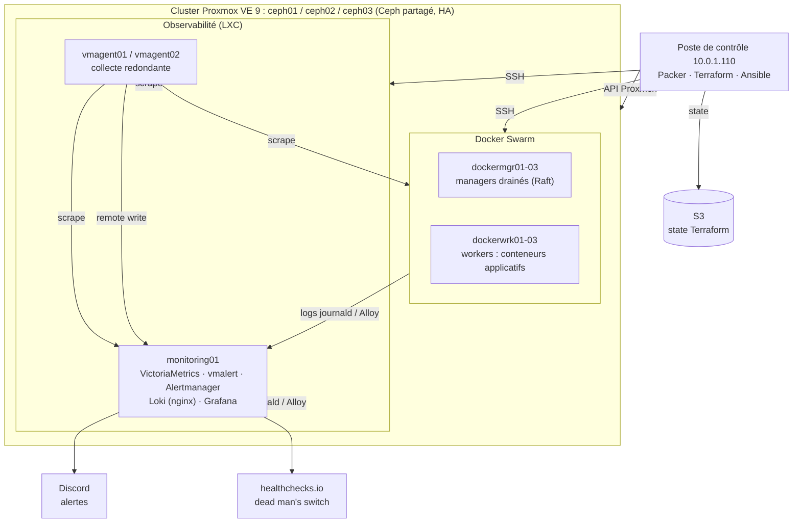

# Architecture et choix techniques de l'infrastructure

Ce document explique **ce qui a été construit, pourquoi, et avec quels compromis**. Le déploiement
pas à pas est dans [deploiement.md](deploiement.md), la supervision dans [supervision.md](supervision.md).

## 1. Objectif

Le sujet demande une plateforme de paiement conteneurisée capable d'encaisser un incident et de
revenir seule à un état utilisable, avec une chaîne d'observabilité qui *alimente réellement*
la détection et la remédiation. L'infrastructure doit donc :

1. **héberger** les microservices (DB, API, authentification, frontal, moteur de remédiation) ;
2. **survivre** elle-même aux pannes, sans quoi la reprise de l'application n'a pas de sens ;
3. **observer** tout le système (hyperviseurs, stockage, orchestrateur, conteneurs, logs) ;
4. **alerter** de façon fiable et fournir un point d'entrée unique au moteur de remédiation ;
5. être **reproductible** : tout est décrit en code, rien n'est configuré à la main.

## 2. Vue d'ensemble

### Plan d'adressage (10.0.1.0/24)

| Plage | Usage | Convention |
|---|---|---|
| .100-.102 | Hyperviseurs ceph01-03 | |
| .110 | Poste de contrôle (dépôt, Terraform, Packer, Ansible) | |
| .200 | IP temporaire du build Packer | |
| .211-.213 | Managers Swarm | VMID = dernier octet |
| .221-.223 | Workers Swarm | VMID = dernier octet |
| .231-.233 | LXC de supervision | VMID = dernier octet |
| .241-.243 | LXC d'identité : Keycloak, Vault, Vaultwarden | VMID = dernier octet |
| .251 | WAF de l'équipe cyber (waf01) : **déplacé en RA-DMZ, 10.30.2.251**, le 21/10 ([waf.md](waf.md)) | VMID = dernier octet |

Groupes Ansible hors du socle : `pve` (hyperviseurs : CA interne, SSO, logs), `control` (.110,
connexion locale : logs) et `waf` (waf01 : **logs seulement**, son firewall appartient à l'équipe
cyber). Détail : [deploiement.md](deploiement.md).
| 172.17.0.0/16 | Bridges Docker locaux (/24 chacun) | hors 10.0.0.0/8 |
| 172.20.0.0/16 | Réseaux overlay Swarm (/24 chacun) | hors 10.0.0.0/8 |

Les plages Docker sont fixées explicitement : les valeurs par défaut peuvent chevaucher le LAN
ou se chevaucher entre bridges locaux et overlays.

## 3. Décisions

Chaque décision est présentée avec le contexte, l'option retenue, les alternatives écartées et
leurs conséquences.

### D1 : un cluster Proxmox de 3 nœuds plutôt qu'un seul PC Hôte

- **Contexte** : le sujet prévoit un PC Hôte sous Docker Desktop. Un poste unique est lui-même un
  point de défaillance : on ne peut pas démontrer de résilience de l'infrastructure dessus.
- **Décision** : un cluster Proxmox VE 9 de 3 nœuds avec stockage Ceph partagé. Ce choix a été
  **validé par le jury**.
- **Conséquences** : on peut perdre un hyperviseur entier sans perdre le service (HA, quorum Raft
  du Swarm, Ceph répliqué). C'est aussi plus lourd à exploiter, d'où l'automatisation complète.

### D2 : Docker Swarm plutôt que Kubernetes

- **Contexte** : l'équipe ne maîtrise pas Kubernetes, et les développeurs ne souhaitent pas écrire
  de charts Helm. Le sujet impose Docker Compose.
- **Décision** : Docker Swarm. Les applications se décrivent en **fichiers Compose**, déployés
  avec `docker stack deploy` : la consigne Compose est respectée et les développeurs gardent le
  format qu'ils connaissent.
- **Ce que Swarm apporte à la reprise** : redémarrage automatique des tâches, healthchecks, mises
  à jour progressives avec retour arrière (`update_config` / `rollback_config`), replanification
  sur un autre nœud, secrets Docker, réseaux overlay isolés. Ce sont les briques que le moteur de
  remédiation pilotera.
- **Alternatives écartées** :
  - Compose seul sur un hôte : aucune tolérance à la panne d'hôte.
  - Kubernetes (k3s) : plus puissant, mais la courbe d'apprentissage n'est pas tenable en 4 jours
    pour l'équipe.
- **Dimensionnement** :
  - **3 managers**, parce que le quorum Raft tolère la perte d'un manager.
  - Avec 2 managers, la perte d'un seul bloquerait le cluster (2 sur 2 requis).
  - Les managers sont **drainés** : ils ne portent aucun conteneur applicatif, donc une
    application qui sature la mémoire ne peut pas déstabiliser le plan de contrôle.
  - **3 workers**, un par hyperviseur.

### D3 : des VM pour Swarm, des LXC pour la supervision

- **Swarm en VM** : Docker dans un LXC pose des problèmes connus :
  - noyau partagé avec l'hyperviseur, d'où une isolation plus faible ;
  - modules overlay et VXLAN, nftables, AppArmor ;
  - fonctionnement imprévisible du réseau overlay.

  Une VM donne un noyau dédié et une frontière de sécurité nette, ce qui compte pour une
  plateforme qui sera attaquée.
- **Supervision en LXC** : des services simples (binaires, paquets Debian) qui n'ont besoin
  d'aucune fonctionnalité noyau particulière. Le LXC est plus léger, démarre plus vite et
  consomme moins de RAM. Les conteneurs sont **non privilégiés**.

### D4 : la chaîne IaC Packer → Terraform → Ansible

| Outil | Rôle | Pourquoi |
|---|---|---|
| **Terraform** (provider `bpg/proxmox`) | Template cloud 9000, VM, LXC, HA | Infrastructure déclarative, plan avant application |
| **Packer** | Template `debian13-docker` (9100) : Docker CE, durcissement SSH et sysctl | Image identique pour tous les nœuds, construite une fois et clonée en quelques secondes |
| **Ansible** | Configuration : daemon Docker, firewall, Swarm init/join, labels, stack de supervision | Idempotent et relançable à tout moment ; sert aussi aux opérations prévues par le sujet |

Packer ne fige que ce qui est **commun** à tous les nœuds. Tout ce qui dépend du rôle (firewall,
Swarm, supervision) est fait par Ansible. Un changement de configuration ne demande donc pas de
reconstruire l'image. Le provider `bpg/proxmox` est retenu parce qu'il est maintenu et couvre les
LXC, le téléchargement d'images et les règles HA de PVE 9.

### D5 : state Terraform distant sur S3, verrou local

- **Contexte** : un state local est perdu avec le poste de contrôle et ne peut pas être partagé.
- **Décision** : backend S3 (bucket `tfstate-epsi`, configuration partielle dans `backend.hcl`,
  non versionnée).
- **Verrouillage** :
  - Le stockage S3 utilisé ne prend pas en charge les écritures conditionnelles : `If-None-Match`
    renvoie 501, donc le verrou natif `use_lockfile` est impossible.
  - Une base dédiée au verrouillage (DynamoDB ou PostgreSQL) serait une brique de plus à opérer
    pour une seule équipe sur un seul poste.
  - Les exécutions sont donc sérialisées par un **verrou `flock` local** dans le wrapper `tf`.
- **Limite** : ce verrou ne protège que le poste de contrôle. Pour plusieurs opérateurs, il
  faudrait un backend avec verrouillage (S3 compatible conditionnel, PostgreSQL, Terraform Cloud).

### D6 : VictoriaMetrics plutôt que Prometheus

La stack est **compatible Prometheus** de bout en bout : format d'exposition, PromQL (MetricsQL
en est un sur-ensemble), remote write, règles d'alerte au format Prometheus, Alertmanager officiel.
Grafana l'interroge comme une source Prometheus. Les raisons du choix :

- **Collecte redondante native** : 2 vmagents identiques, avec dédoublonnage côté stockage
  (`-dedup.minScrapeInterval`). Avec Prometheus, il faudrait 2 serveurs complets, ou Thanos ou
  Mimir pour dédoublonner.
- **Tampon disque** : si le stockage est indisponible, vmagent garde les échantillons et les
  renvoie au retour. C'est testé : 90 s de coupure de monitoring01 sans aucun trou.
- **Ressources** : RAM et disque nettement plus faibles à volume égal. La stack tient dans
  10 Go de RAM au total.

Détails dans [supervision.md](supervision.md).

### D7 : haute disponibilité Proxmox sur toutes les machines

- Toutes les VM et tous les LXC sont des ressources HA (`max_restart 2`, `max_relocate 1`).
  Si un hyperviseur tombe, ses invités redémarrent sur les deux autres grâce au stockage Ceph
  partagé.
- **Préférence de nœud non stricte avec retour automatique** : chaque invité revient sur son nœud
  d'origine quand celui-ci remonte, ce qui rétablit seul la répartition « 1 manager + 1 worker par
  hyperviseur ».
- **Anti-affinité stricte des 2 vmagents** : ils ne sont jamais sur le même hôte. La règle reste
  satisfaisable avec 3 nœuds, même après une panne.
- **Pas d'anti-affinité stricte sur les managers** : avec 3 nœuds et un nœud perdu, elle
  empêcherait de redémarrer le troisième manager. Mieux vaut deux managers temporairement sur le
  même hôte qu'un manager arrêté.
- **Couches complémentaires** :

  | Couche | Ce qu'elle redémarre | Délai |
  |---|---|---|
  | HA Proxmox | Les machines | En minutes |
  | Swarm | Les conteneurs | En secondes |
  | Moteur de remédiation | Les actions métier | Sur alerte |

### D8 : sécurité du socle

- **Accès** :
  - SSH par clé uniquement, root interdit sur les VM, durcissement sysctl intégré au template.
  - Comptes système dédiés pour chaque service de supervision, avec durcissement systemd
    (`NoNewPrivileges`, `ProtectSystem=strict`…).
- **Firewall nftables sur chaque machine, politique par défaut `drop`** :
  - SSH limité au réseau d'administration ;
  - ports Swarm limités aux nœuds Swarm ;
  - ports d'exporters limités aux deux collecteurs ;
  - depuis le VPN d'administration (`fw_admin_web_allowed` : 10.10.0.0/24),
    **uniquement les interfaces web** (`fw_admin_ports` : Grafana, vmui, vmalert, Alertmanager,
    Keycloak, Vault, Vaultwarden). Le SSH passe par le poste de contrôle ;
  - la table est gérée de façon isolée (`inet host_fw`) sans vider le ruleset, pour ne pas casser
    les règles de Docker.
- **Authentification** sur toutes les API de supervision :
  - VictoriaMetrics, vmagent, vmalert et Alertmanager en natif ;
  - Loki derrière nginx ;
  - chaque client s'authentifie, y compris Grafana en local.
- **Secrets** :
  - Jamais dans le dépôt : ils sont dans HashiCorp Vault, lus à chaque exécution par
    `vault-env` (AppRole `ansible`, utilisable depuis le poste de contrôle seulement).
  - Sur les serveurs, ils sont écrits dans des fichiers en `0640` lisibles par le seul service
    concerné, avec `no_log` côté Ansible.
  - Le diff sortant est scanné avant chaque push.
- **Moindre privilège Proxmox** :
  - la supervision lit l'API avec un token `PVEAuditor`, en lecture seule ;
  - Terraform et Packer ont chacun leur token ;
  - les tokens à privilèges séparés reçoivent une ACL explicite.

### D9 : une chaîne d'alerte qui se surveille elle-même

- **Routage** : vmalert évalue les règles et Alertmanager les achemine :
  - vers Discord pour les humains ;
  - vers un futur webhook pour le moteur de remédiation, qui aura ainsi **un point d'entrée
    unique**.
- **Watchdog** : une alerte toujours active, envoyée chaque minute à healthchecks.io, un service
  externe au cluster. Si le Watchdog cesse d'arriver, c'est que la chaîne est morte (stockage,
  vmalert, Alertmanager, réseau ou hyperviseur), et healthchecks.io prévient. Ce « dead man's
  switch » répond à la question : qui surveille la surveillance ?
- **Choix de l'alerting** : celui de Grafana a été écarté pour ne pas faire de Grafana un point
  de panne de la chaîne d'alerte.

### D10 : identités et secrets séparés en trois services, hors du Swarm

- **Contexte** : les secrets de l'infra vivaient dans des fichiers d'environnement réservés à root
  sur le poste de contrôle, et chaque outil avait son propre compte admin local. Le sujet impose
  HashiCorp Vault ou SOPS pour les secrets (§3.4).
- **Décision** : trois outils, chacun pour un besoin, dans trois LXC dédiés (un par hyperviseur) :
  - **Keycloak** pour l'authentification unique des administrateurs, avec double authentification
    et droits par groupe ;
  - **Vault** pour les secrets des machines, avec audit de chaque lecture ;
  - **Vaultwarden** pour les mots de passe que le SSO ne couvre pas : comptes de secours, comptes
    externes, clés de descellement de Vault.
- **Hors du Swarm** : la plateforme attaquée ne partage ni noyau ni réseau overlay avec eux.
- **Installation native** : Vaultwarden n'existe qu'en image Docker, et Docker en LXC non
  privilégié exige l'option `keyctl`, réservée à `root@pam`. Le binaire statique est extrait de
  l'image officielle épinglée par empreinte.
- **CA interne** : HTTPS est obligatoire (Vaultwarden, OIDC, Vault). La clé de la CA reste sur le
  poste de contrôle ; son certificat est dans le magasin de confiance de toutes les machines.
- **Alternatives écartées** : SOPS seul (pas d'audit des lectures, pas de SSO) ; Authentik
  (plus simple, mais Keycloak est le standard du secteur bancaire, plus facile à défendre).
- **Mise en œuvre (20/10/2026)** : tous les secrets d'infra sont migrés dans Vault et les
  fichiers `.env` détruits ; Ansible et Terraform les lisent par l'AppRole `ansible` ; tous les
  secrets renouvelables ont été changés ([comptes-et-rotation.md](comptes-et-rotation.md)).
- **Conséquences** : Vault doit être descellé après chaque redémarrage (`vault-unseal`, alerte
  `VaultSealed`), sans impact sur l'application déjà déployée ; tant qu'il est scellé, Ansible et
  Terraform ne peuvent pas tourner. Détails : [identites.md](identites.md).

## 4. Correspondance avec le sujet (§3.2 Infrastructure)

| Exigence | Réponse |
|---|---|
| Déploiement reproductible | Packer, Terraform et Ansible versionnés, playbooks idempotents ; [deploiement.md](deploiement.md) |
| Docker Compose pour définir et orchestrer | Applications en fichiers Compose, déployées par `docker stack deploy` sur Swarm |
| Playbooks Ansible pour les opérations | `swarm.yml`, `monitoring.yml`, `site.yml` ; playbooks de remédiation à brancher sur Alertmanager |
| Prometheus pour les métriques | Stack compatible Prometheus (VictoriaMetrics, choix validé) |
| Grafana | Grafana 13, dashboards provisionnés depuis le dépôt |
| Loki pour les journaux | Loki 3.7, les 17 machines (dont hyperviseurs et WAF) et les conteneurs via journald et Alloy |
| Pas d'Elastic Stack | Aucun composant Elastic |
| Interfaces internes non exposées (§4) | DB, secrets et interfaces de gestion filtrés par firewall et authentifiés |
| Aucun secret en clair dans l'archive (§7.4) | Secrets hors dépôt, scan avant chaque push |
| Gestion des secrets avec Vault ou SOPS (§3.4) | HashiCorp Vault (audit, KV v2) : tous les secrets infra y sont, lus par AppRole ; rotation documentée ([comptes-et-rotation.md](comptes-et-rotation.md)) |

## 5. Limites connues et ce qu'on ferait en contexte industriel

| Limite actuelle | Risque | En production |
|---|---|---|
| Application isolée en VLAN (`RA-APP`), mais supervision et identité partagent `MANAGEMENT` avec les hyperviseurs ([reseau.md](reseau.md)) | Une compromission de la supervision ou de l'identité donne accès au réseau d'administration | VLAN dédiés pour la supervision, l'identité et le stockage |
| Un seul lien corosync | Une coupure de ce lien peut déclencher un fencing | Deux liens corosync sur des réseaux distincts |
| VictoriaMetrics single-node, Loki monolithique | Point unique, atténué par la HA Proxmox et le tampon vmagent | Cluster VictoriaMetrics et Loki en mode distribué avec stockage objet |
| HTTP sans TLS dans la supervision (les services d'identité sont en HTTPS) | Identifiants Basic lisibles sur le LAN | TLS partout avec la CA interne, SSO / OIDC pour Grafana |
| Un compte par service, avec tous les droits | Le ML aurait aussi le droit d'écrire et de supprimer | vmauth avec des comptes en lecture seule, séparation lecture / écriture |
| Identifiants de l'AppRole et (jusqu'après la démo) clés de descellement sur le poste de contrôle | Le poste de contrôle reste un point sensible | `secret_id` à durée courte, token root révoqué, rotation automatique (secrets dynamiques) |
| Vault et Keycloak à nœud unique, sans descellement automatique | Intervention humaine après un redémarrage de Vault | Vault Raft à 3 nœuds avec auto-unseal (KMS/HSM), Keycloak en cluster |
| Clé de la CA interne sur le poste de contrôle | Compromission de .110 = émission de certificats valides | CA racine hors ligne, CA intermédiaire dans Vault |
| Verrou Terraform local | Pas d'accès concurrent possible | Backend avec verrouillage partagé, exécution en CI |
| 3 nœuds sur un seul site | Aucune tolérance à un sinistre de site | Second site ou sauvegardes externalisées (PBS distant), PRA testé |
| Sauvegardes : PBS en cours de mise en place | Pas de restauration testée à ce jour | Sauvegardes planifiées, tests de restauration réguliers et mesurés (RTO / RPO) |
