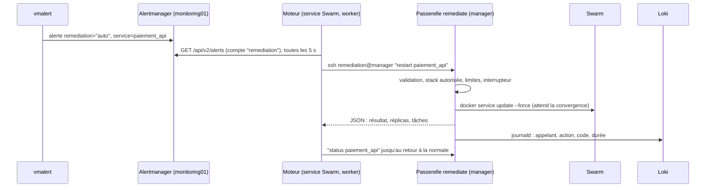

# Passerelle de remédiation

Le moteur de remédiation, développé par l'équipe applicative, décide **quoi** faire.
La passerelle, fournie par l'infra, est le **seul moyen** dont il dispose pour agir sur le
cluster : une liste fermée d'actions, avec des garde-fous, et tracée.

Le sujet le demande explicitement (§3.4) : le moteur dispose de droits élevés sur les
conteneurs, il ne doit pas devenir une interface d'administration accessible à n'importe quel
composant. Lui donner accès au socket Docker reviendrait à lui donner root sur tout le cluster.

## 1. Chaîne complète



- **Le moteur lit les alertes**, il ne reçoit pas de webhook : il n'a ainsi aucun port entrant
  (voir le contrat de déploiement, §8).
- La vérification du rétablissement passe par `status`, par la sonde de transaction (à venir)
  et par la résolution de l'alerte.

## 2. Composants (rôle Ansible `remediation_gateway`, sur les 3 managers)

| Élément | Emplacement | Rôle |
|---|---|---|
| Utilisateur `remediation` | managers | Sans mot de passe, connexion par clé uniquement |
| Clé autorisée | `/home/remediation/.ssh/authorized_keys` (appartient à root) | `restrict` (pas de shell interactif, de redirection de ports ni d'agent), `from=` limité aux 3 workers, commande forcée |
| Commande forcée | `/usr/local/bin/remediate-ssh` | Découpe la commande demandée en arguments, sans shell ni globbing, puis appelle la passerelle via sudo |
| Droit sudo | `/etc/sudoers.d/remediation` | Uniquement `/usr/local/sbin/remediate` |
| Passerelle | `/usr/local/sbin/remediate` (Python, root) | Valide, applique la politique, exécute, journalise |
| Politique | `/etc/remediation/policy.json` | Stacks autorisées, bornes, limites (générée depuis les variables Ansible) |
| Interrupteur d'arrêt | `/etc/remediation/disabled` | S'il existe, toute action modifiante est refusée |
| État des limites | `/var/lib/remediation/state.json` | Horodatage des actions (fenêtre glissante, délai par service) |

**Secrets et configs Swarm** créés par le rôle, à monter dans le service du moteur :

| Nom | Type | Contenu |
|---|---|---|
| `remediation_ssh_key` | secret | Clé privée du moteur. Générée sur le poste de contrôle (`/root/.remediation/`), jamais versionnée |
| `remediation_known_hosts` | config | Empreintes SSH des 3 managers : le moteur vérifie l'hôte, sans faire confiance au premier contact |
| `remediation_alertmanager_password` | secret | Mot de passe du compte Alertmanager `remediation` |

## 3. Actions

| Commande | Effet | Modifiante |
|---|---|---|
| `list` | Services des stacks autorisées et leurs réplicas | non |
| `status <service>` | Réplicas voulues et en marche, état de la dernière mise à jour, tâches et erreurs | non |
| `restart <service>` | `docker service update --force` : remplacement progressif des conteneurs, attente de la convergence | oui |
| `rollback <service>` | `docker service rollback` : retour à la version précédente (image, configuration) | oui |
| `scale <service> <n>` | Nombre de réplicas, dans les bornes de la politique | oui |

La sortie est **un objet JSON** sur stdout. Le code retour indique le résultat :

| Code | Signification |
|---|---|
| 0 | Succès |
| 2 | Requête invalide (commande inconnue, nom de service mal formé, service inexistant) |
| 3 | Refusé par la politique (stack non autorisée, bornes, interrupteur d'arrêt) |
| 4 | Limite de débit atteinte (`retry_in` indique l'attente en secondes) |
| 5 | Échec Docker ou délai de convergence dépassé |

Juste après un `restart`, `update_status` peut encore indiquer `updating` alors que les
réplicas sont revenues : le moteur doit confirmer avec `status` et la sonde de transaction.

## 4. Garde-fous

- **Validation stricte** : nom de service `^[a-z0-9][a-z0-9_.-]{0,62}$`, nombre d'arguments
  fixe par action, réplicas entières. Aucune commande n'est passée à un shell : la passerelle
  appelle `docker` avec une liste d'arguments.
- **Périmètre** : seules les stacks de `remediation_allowed_stacks`
  (`infra/ansible/inventory/group_vars/swarm.yml`) sont pilotables. La supervision, la
  passerelle et tout service hors de ces stacks sont inaccessibles.
- **Bornes** : réplicas entre `remediation_scale_min` (1) et `remediation_scale_max` (6).
- **Débit** : au plus `remediation_max_actions` (10) actions modifiantes par fenêtre de
  `remediation_window_seconds` (10 min), et `remediation_cooldown_seconds` (60 s) entre deux
  actions sur un même service. Ça empêche un moteur en boucle ou détourné de faire tourner un
  service en continu.
- **Délai** : une action qui ne converge pas en `remediation_timeout_seconds` (180 s) renvoie
  le code 5. Le moteur peut alors escalader, par exemple avec un `rollback` ou une alerte humaine.
- **Interrupteur d'arrêt** : `touch /etc/remediation/disabled` sur les managers coupe la
  remédiation automatique. `status` et `list` restent disponibles.
- **Traçabilité** : chaque appel, accepté ou refusé, est journalisé (identifiant
  `remediate`, IP de l'appelant, code, résultat) et part dans Loki :

```logql
{identifier="remediate"}
{identifier="remediate"} |~ "code=[2-5]"     # refus et échecs
```

## 5. Tests

`infra/remediation/test-passerelle.sh`, lancé depuis le poste de contrôle, teste le chemin
réel :
- il déploie si besoin la stack `demo` ([demo-stack.yml](../remediation/demo-stack.yml)) ;
- il lance un conteneur sur un worker avec le secret et la config Swarm ;
- il joue une série de cas.

Résultat au 19/10/2026 : **11 cas sur 11 conformes**.

| Cas | Attendu | Obtenu |
|---|---|---|
| `list`, `status demo_web` | 0 | 0 |
| commande vide, `status demo_web;id`, `restart ../../etc` | 2 | 2 |
| `status monitoring_vmagent` (stack non autorisée), `scale demo_web 99` | 3 | 3 |
| `restart demo_web` | 0 (39 s) | 0 |
| `restart demo_web` immédiatement après | 4 | 4 |
| `scale demo_web 3`, puis `rollback demo_web` | 0 | 0 |

Vérifié aussi :
- la clé du moteur utilisée depuis le poste de contrôle (hors workers) est refusée par SSH ;
- l'interrupteur d'arrêt bloque `restart` (code 3) ;
- les actions apparaissent dans Loki avec l'IP du worker appelant.

## 6. Exploitation

- **Autoriser la stack applicative** : ajouter son nom à `remediation_allowed_stacks`, puis
  lancer `vault-env ansible-playbook swarm.yml --limit swarm_managers`.
- **Faire tourner la clé du moteur** :
  1. supprimer `/root/.remediation/id_ed25519*` sur le poste de contrôle ;
  2. retirer le secret du service du moteur, puis `docker secret rm remediation_ssh_key` ;
  3. relancer `swarm.yml`, qui régénère la clé et recrée le secret ;
  4. remonter le secret dans le moteur.

  Les secrets Swarm sont immuables : un secret utilisé par un service ne peut pas être remplacé
  sur place.
- **Couper la remédiation automatique pendant une intervention** :
  `ansible swarm_managers -b -m file -a "path=/etc/remediation/disabled state=touch"`
  (puis `state=absent` pour la réactiver).

## 7. Limites et suites

- **Limites de débit par manager** : chaque manager compte ses propres actions. Un moteur qui
  alternerait entre managers aurait jusqu'à 3 fois la limite. Une limite commune demanderait
  un état partagé (fichier sur Ceph, ou compteur dans le moteur).
- **La clé est utilisable depuis n'importe quel worker**, mais seulement par un service à qui
  le secret Swarm a été donné. Un conteneur compromis sans ce secret ne peut pas l'utiliser.
- **Actions à ajouter avec l'équipe cyber** :
  - `isolate` : retirer un service compromis de ses réseaux en le gardant pour l'investigation ;
  - `rotate-secret` : nouveau secret Docker, puis mise à jour du service ;
  - blocage d'une IP au WAF.

  Ces actions dépendent de la stack applicative et du WAF, encore à venir.
- **Restauration de données** : `restart` et `rollback` rétablissent la disponibilité, pas
  l'intégrité des données. Une injection ou une corruption demande une restauration de la
  base (PBS ou dump logique), prévue quand la base existera.
