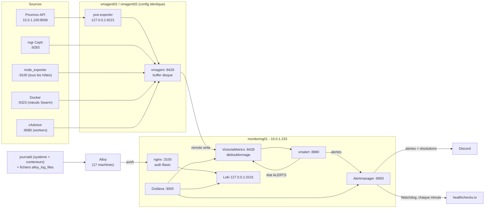

# Supervision : métriques, logs, alertes

La stack d'observabilité surveille le cluster Proxmox (hyperviseurs, invités, Ceph), le cluster
Docker Swarm et, à terme, les applications qui y tournent. Elle tourne dans 3 LXC créés par
`infra/terraform/monitoring.tf` et configurés par `infra/ansible/monitoring.yml`.

| LXC | IP | Hyperviseur d'origine | Rôle |
|---|---|---|---|
| vmagent01 | 10.0.1.231 | ceph02 | collecte (vmagent + pve-exporter) |
| vmagent02 | 10.0.1.232 | ceph03 | collecte (vmagent + pve-exporter), copie identique |
| monitoring01 | 10.0.1.233 | ceph01 | VictoriaMetrics, vmalert, Alertmanager, Loki (+ nginx), Grafana |

## 1. Vue d'ensemble



En résumé :

- **Métriques** : les 2 vmagents scrapent toutes les cibles toutes les 30 s et écrivent dans
  VictoriaMetrics, qui ne garde qu'un échantillon par série et par intervalle.
- **Alertes** : vmalert évalue les règles sur VictoriaMetrics et envoie les alertes à
  Alertmanager, qui les route vers Discord. L'alerte Watchdog part vers healthchecks.io.
- **Logs** : sur chaque machine (VM, LXC, hyperviseurs, poste de contrôle, WAF), Alloy lit
  journald, où arrivent aussi les logs des conteneurs Docker, et quelques fichiers de logs. Il
  pousse vers Loki à travers nginx.
- **Visualisation** : Grafana interroge les trois sources.

Versions déployées : VictoriaMetrics v1.154.0 (binaires officiels, somme de contrôle vérifiée),
Alertmanager 0.28 (paquet Debian), Loki 3.7, Grafana 13 et Alloy 1.20 (dépôt APT Grafana Labs).
cAdvisor tourne en v0.60.6 et prometheus-pve-exporter en 3.10.1.

## 2. Où sont les fichiers de configuration

Toutes les configurations de la supervision sont dans **`infra/monitoring/`**. Les rôles Ansible
ne contiennent que l'installation, les services systemd et les secrets ; ils vont chercher les
fichiers dans ce dossier (variable `monitoring_config_dir`). Les fichiers `.j2` sont des
**templates Jinja2** : les cibles, IP et ports sont générés depuis l'inventaire. Ajouter une machine dans `inventory/hosts.yml` l'ajoute donc
automatiquement aux scrapes, aux dashboards et aux logs, sans modifier la configuration à la main.

| Équivalent « classique » | Fichier dans le dépôt (`infra/`) | Déployé sur |
|---|---|---|
| `prometheus.yml` (scrape) | `monitoring/vmagent/scrape.yml.j2` | vmagent01-02 : `/etc/vmagent/scrape.yml` |
| Options du serveur Prometheus (rétention, dédup) | `ansible/roles/vmsingle/templates/victoria-metrics.service.j2` | monitoring01 |
| Règles d'alerte (`rules/*.yml`) | `monitoring/vmalert/rules/*.yml` (tous les fichiers du dossier sont déployés) | monitoring01 : `/etc/vmalert/rules/` |
| `alertmanager.yml` | `monitoring/alertmanager/alertmanager.yml.j2` | monitoring01 : `/etc/prometheus/alertmanager.yml` |
| `loki.yml` | `monitoring/loki/config.yml.j2` | monitoring01 : `/etc/loki/config.yml` |
| Reverse proxy de Loki | `monitoring/loki/nginx-loki.conf.j2` | monitoring01 |
| Agent de logs (promtail / Alloy) | `monitoring/alloy/config.alloy.j2` | les 17 machines de l'inventaire : `/etc/alloy/config.alloy` |
| Sources de données Grafana | `monitoring/grafana/datasources.yml.j2` | monitoring01 |
| Dashboards Grafana (JSON) | `monitoring/grafana/dashboards/<Dossier>/*.json` | monitoring01 : `/var/lib/grafana/dashboards/` |
| Générateurs de dashboards | `monitoring/grafana/scripts/` | (poste de contrôle) |
| Paramètres (versions, rétentions, intervalle) | `inventory/group_vars/monitoring.yml` | |

Pour voir le fichier final rendu sur un serveur, par exemple le `scrape.yml` :
`ansible vmagent01 -m command -a 'cat /etc/vmagent/scrape.yml'`.

## 3. Pourquoi VictoriaMetrics et non Prometheus

Le sujet demande Prometheus. Nous avons gardé tout l'écosystème Prometheus (format d'exposition,
exporters, PromQL, règles d'alerte, Alertmanager) et seulement remplacé le serveur de stockage
par VictoriaMetrics. Le jury a validé ce choix.

| Critère | Ce que ça apporte ici |
|---|---|
| Compatibilité | Mêmes exporters, même format de scrape, API de requête Prometheus : Grafana utilise la source de type `prometheus`, et les règles vmalert sont au format Prometheus |
| Collecte redondante | Deux collecteurs qui scrapent la même chose ne posent pas de problème : `-dedup.minScrapeInterval=30s` fusionne les doublons. Avec Prometheus, il faudrait deux serveurs complets, puis Thanos ou une déduplication côté requête |
| Résistance aux coupures | vmagent garde sur disque ce qu'il n'a pas pu envoyer (jusqu'à 8 Go) et le renvoie au retour du stockage. Le remote write de Prometheus ne garde que quelques heures en mémoire/WAL |
| Ressources | Moins de RAM et de disque que Prometheus pour le même volume, ce qui compte sur des LXC partagés avec le reste du lab |
| Exploitation | Un binaire par composant, sans dépendance. vmui (`:8428/vmui`) remplace l'interface de Prometheus |

Le format reste compatible : revenir à Prometheus voudrait dire remplacer le serveur, pas
réécrire les exporters, les dashboards ou les règles.

## 4. Haute disponibilité de la collecte

- **2 vmagents identiques** : même `scrape.yml` (sans label propre à l'agent), donc mêmes séries.
  VictoriaMetrics déduplique. Si un vmagent tombe, aucune donnée n'est perdue et l'alerte
  `VmagentRedundancyLost` se déclenche.
- **Jamais sur le même hyperviseur** : la règle HA Proxmox `vmagents-apart` (anti-affinité,
  `infra/terraform/ha.tf`) les garde séparés, y compris après une bascule.
- **Buffer disque** : si monitoring01 ne répond plus, chaque vmagent accumule dans
  `/var/lib/vmagent/remotewrite` puis rattrape son retard. Nous l'avons testé avec 90 s de
  coupure, sans trou dans les courbes. Au-delà de 100 Mo en attente pendant 10 min, l'alerte
  `VmagentRemoteWriteBacklog` se déclenche.
- **Exporter Proxmox local** : chaque vmagent interroge son propre pve-exporter sur
  `127.0.0.1:9221`. La même adresse sur les deux agents donne les mêmes séries.

**Limite** : VictoriaMetrics, vmalert, Alertmanager, Loki et Grafana sont sur un seul LXC
(monitoring01). Si ce LXC tombe :

- la HA Proxmox le redémarre sur un autre nœud, grâce au stockage Ceph partagé ;
- les vmagents gardent les métriques en attente pendant ce temps ;
- healthchecks.io prévient si la chaîne d'alerte reste coupée.

Les logs Alloy sont réessayés pendant un temps limité, au-delà ils peuvent être perdus. En
production, on passerait à VictoriaMetrics en cluster et à 2 Alertmanager en gossip.

## 5. Sources de métriques

Configuration : `monitoring/vmagent/scrape.yml.j2`. Intervalle de scrape : 30 s.

| Job | Cibles | Port | Ce que ça mesure |
|---|---|---|---|
| `node` | 6 VM Swarm, 6 LXC, 3 hyperviseurs | 9100 | CPU, RAM, disques, réseau, charge, PSI de chaque machine (labels `host`, `role`, `pve_node`) |
| `pve` | API Proxmox (10.0.1.100) via l'exporter local | 127.0.0.1:9221 | État des nœuds, des VM et LXC (CPU, RAM, disque, réseau), des stockages, et métadonnées HA. Une seule cible : les métriques `cluster` couvrent tous les nœuds. Le token est `PVEAuditor` (lecture seule) |
| `ceph` | Les 3 hyperviseurs | 9283 | Module `prometheus` du mgr Ceph : santé, OSD, MON, pools, capacité, I/O, latences. Seul le mgr actif répond. `instance` est forcé à `ceph` et `honor_labels` est activé, pour que les séries ne changent pas quand le mgr bascule |
| `docker` | Les 6 nœuds Swarm | 9323 | Métriques du démon Docker et du Swarm (`swarm_manager_nodes`, `swarm_manager_leader`…) |
| `cadvisor` | Les 3 workers | 8080 | CPU, RAM, réseau et I/O par conteneur, avec les labels service et stack Swarm. Les managers sont drainés et n'hébergent aucun conteneur, d'où l'absence de cAdvisor dessus |
| `keycloak` | iam01 | 9000 (HTTPS) | Santé et métriques de Keycloak (interface de gestion) |
| `vault` | vault01 | 8200 (HTTPS) | Métriques de Vault, dont `vault_core_unsealed` (1 = descellé). Lisibles sans token, port filtré par le firewall |
| `vmagent`, `victoriametrics`, `vmalert`, `alertmanager`, `loki`, `grafana` | La stack elle-même | 8429, 8428, 8880, 9093, 3100, 3000 | Santé de la chaîne de supervision (authentification Basic, sauf Grafana) |

cAdvisor tourne hors Swarm, en réseau `host` : son port passe ainsi par le pare-feu de l'hôte, ce
qui n'est pas le cas d'un port publié par Swarm.

**Services applicatifs** : un second vmagent tourne *dans* le Swarm (stack `monitoring`,
`infra/monitoring/swarm/`). Les vmagents des LXC ne voient pas les réseaux overlay, et la
découverte par l'API Docker obligerait à exposer celle-ci. Ce vmagent :

- est attaché au réseau overlay chiffré `monitoring`, que les services exposant des métriques
  rejoignent ;
- trouve chaque réplica par DNS (`tasks.<service>`), sans accès à l'API Docker ;
- envoie ses séries à VictoriaMetrics en remote write authentifié (secret Swarm
  `vm_auth_password`), avec un tampon disque de 1 Go.

Les cibles sont déclarées dans `swarm_scrape_targets` (`inventory/group_vars/swarm.yml`). Chaque
service devient un `job`, avec les labels `service` et `stack`. Règles côté développeurs :
[contrat-deploiement.md](contrat-deploiement.md#4-métriques).

### Métriques de l'application (stack `paiement`)

| Job (= `service`) | Découverte | Métriques |
|---|---|---|
| `paiement_payment-api` | `tasks.paiement_payment-api:8000/metrics` | `payments_total{provider, status}` (stripe/paypal × ok/refused/error), `http_requests_total{method, route, code}`, `http_request_duration_seconds{method, route}` (histogramme), `payment_api_dependency_up{dependency}` (stripe, paypal, db) |
| `paiement_auth` | `tasks.paiement_auth:8300/metrics` | `auth_login_total{result}` (success, failure, locked), `auth_signup_total{result}`, `auth_reset_total{result}` |
| `probe_transactions` (stack `probe`) | `tasks.probe_transactions:9110/metrics` | `paiement_probe_*` : sonde de transaction par le relais public, recopie du score du détecteur et de l'état du moteur ([application.md](application.md#sonde-de-transaction-et-dashboard-démo)) |

- `route` est le **modèle** de route FastAPI (`/api/payment_intents/{intent_id}`), jamais l'URL
  brute ; une URL inconnue (scan) compte sous `route="unmatched"`. `/metrics` n'est pas compté.
- Les sondes `/api/status` et `/api/health` (détecteur, moteur, canary : une par seconde chacun)
  **sont comptées** dans `http_requests_total` : les requêtes métier s'obtiennent avec
  `route!~"/api/(status|health)"`.
- `payment_api_dependency_up{dependency="db"}` est rafraîchi en tâche de fond (2 s).
  `stripe` et `paypal` ne le sont que par un appel à `/api/status` : une réplica que personne
  ne sonde garde sa dernière valeur (0 au démarrage).
- Le frontal (`paiement_frontend`, nginx) n'expose pas de métriques : sa disponibilité se lit
  dans cAdvisor et ses logs dans Loki.

Requêtes utiles (vmui, Grafana) :

```promql
# Paiements par minute, par issue
sum by (status) (rate(payments_total[5m])) * 60
# Taux de 5xx de payment-api, hors sondes
sum(rate(http_requests_total{service="paiement_payment-api", route!~"/api/(status|health)", code=~"5.."}[5m]))
  / sum(rate(http_requests_total{service="paiement_payment-api", route!~"/api/(status|health)"}[5m]))
# Latence p95 par route
histogram_quantile(0.95, sum by (le, route) (rate(http_request_duration_seconds_bucket{service="paiement_payment-api"}[5m])))
# Échecs de connexion par seconde
sum by (result) (rate(auth_login_total[5m]))
```

Déploiement de la collecte : `vault-env ansible-playbook swarm.yml --limit 'swarm_managers[0]'`
(rôle `swarm_monitoring` : nouvelle config Swarm nommée par empreinte, vmagent redéployé).
Vérification sans accès au conteneur : `vm_promscrape_config_last_reload_successful{service="monitoring_vmagent"}`
doit valoir 1, puis `up{stack="paiement"}` doit valoir 1 pour chaque réplica.

## 6. Logs

### Collecte

**Grafana Alloy sur les 17 machines de l'inventaire** (rôle `alloy`) :

| Machines | Groupe | Play |
|---|---|---|
| 6 VM Swarm | `swarm` | `swarm.yml` |
| 3 LXC de supervision, 3 LXC d'identité | `monitoring`, `identity` | `monitoring.yml`, `identity.yml` (avec `lxc_base`) |
| 3 hyperviseurs | `pve` | `monitoring.yml`, play « Envoi des logs » |
| Poste de contrôle (control01 = .110, connexion locale) | `control` | idem |
| WAF de l'équipe cyber (waf01, 10.30.2.251, RA-DMZ) | `waf` | idem. **Seul le rôle `alloy`** y est appliqué : la VM et son firewall nftables appartiennent à l'équipe cyber. Alloy y suit les rotations du mot de passe de Loki |

- **journald** : Alloy lit le journal systemd (groupe `systemd-journal` seulement). Docker
  utilise le driver `journald` : les logs des conteneurs passent par le même chemin, sans accès
  au socket Docker.
- **Fichiers** (`alloy_log_files`, par groupe) : journaux écrits hors journald.

  | Fichier | Machines | `job` |
  |---|---|---|
  | `/var/log/pveproxy/access.log` | Hyperviseurs | `pveproxy` (accès à l'interface web et à l'API Proxmox) |
  | `/var/log/postgresql/postgresql-*-main.log` | iam01 | `postgresql` (connexions et erreurs de la base de Keycloak) |

  Lecture par **ACL** sur le seul répertoire concerné (et ACL par défaut, pour les fichiers que
  logrotate recrée). Alloy n'est **pas** ajouté au groupe `www-data` : sur un hyperviseur, ce
  groupe lit `/etc/pve` (secrets du cluster, dont celui du client OIDC).
- **Envoi** : vers `http://10.0.1.233:3100/loki/api/v1/push`, en authentification Basic.
- **Rétention** : 14 jours (`loki_retention: 336h`), stockage local TSDB, compactor actif.

**Limite : Ceph.** Ses journaux sont en `0600` et logrotate les recrée ainsi : ils ne sont pas
collectés. La santé de Ceph est suivie par les métriques (job `ceph`, alertes `CephHealth*`).

### Labels

| Label | Origine |
|---|---|
| `job` | `journal` (journald), `pveproxy` ou `postgresql` (fichiers) |
| `host`, `role`, `pve_node` | inventaire Ansible |
| `unit` | unité systemd |
| `level` | priorité journald (`err`, `warning`, `info`…) |
| `identifier` | identifiant syslog (nom du processus, tag nginx…) |
| `service`, `stack` | service et stack Swarm (conteneurs Swarm uniquement) |
| `container` | nom du conteneur, pour les conteneurs **hors Swarm** seulement (ex. WAF). Les tâches Swarm, dont le nom change à chaque déploiement, n'ont que `service` et `stack` |

### Requêtes LogQL

Grafana > Explore > Loki :

```logql
# Logs d'un service Swarm (nom d'exemple : remplacer par le service réel)
{service="paiement_api"}

# Erreurs sur tous les nœuds Swarm
{role=~"swarm_.*", level=~"err|crit|alert|emerg"}

# Mots-clés d'erreur dans les logs d'une stack
{stack="paiement"} |~ "(?i)error|exception|timeout"

# Débit de logs par hôte
sum by (host) (rate({job="journal"}[5m]))
```

Requêtes utiles pour le SIEM :

```logql
# Keycloak : échecs de connexion (événements de sécurité)
{host="iam01"} |= "org.keycloak.events" |= "LOGIN_ERROR"

# Keycloak : échecs par minute (base d'une règle de détection de force brute)
sum(count_over_time({host="iam01"} |= "org.keycloak.events" |= "LOGIN_ERROR" [1m]))

# Proxmox : accès à l'interface et à l'API refusés (401/403)
{job="pveproxy"} |~ `" (401|403) `

# Hyperviseurs : échecs SSH
{role="pve", unit="ssh.service"} |~ "Failed password|Invalid user"

# Vault : journal d'audit (chaque requête), et accès refusés
{identifier="vault-audit"}
{identifier="vault-audit"} |= "permission denied"

# PostgreSQL de Keycloak : échecs d'authentification
{job="postgresql"} |= "authentication failed"

# Loki : identifiants refusés par nginx (401), y compris un client resté sur l'ancien mot de passe
{identifier="nginx_loki"}

# Alloy : lots de logs abandonnés (ex. pendant une rotation de mot de passe)
{unit="alloy.service"} |= "dropping data"

# WAF : logs des conteneurs hors Swarm
{host="waf01", container=~".+"}
```

Les erreurs de nginx devant Loki (dont les 401) passent par journald, avec l'identifiant
`nginx_loki`.

## 7. Alerting

### Règles (vmalert)

Fichiers : `monitoring/vmalert/rules/`. Elles sont évaluées toutes les 30 s. L'état des alertes
est réécrit dans VictoriaMetrics et survit à un redémarrage de vmalert.

| Alerte | Condition | Durée | Sévérité |
|---|---|---|---|
| `Watchdog` | toujours vraie (`vector(1)`) | - | none |
| `TargetDown` | une cible ne répond plus (`up == 0`, Ceph exclu car ses mgr standby sont « down » normalement) | 2 min | warning |
| `VmagentRedundancyLost` | moins de 2 vmagents actifs | 5 min | warning |
| `VmagentRemoteWriteBacklog` | plus de 100 Mo en attente dans le buffer d'un vmagent | 10 min | warning |
| `DiskSpaceLow` | moins de 10 % d'espace libre sur un système de fichiers | 10 min | critical |
| `PveNodeDown` | un nœud Proxmox hors ligne (`pve_up`) | 1 min | critical |
| `PveExporterDown` | API Proxmox injoignable | 2 min | warning |
| `CephMetricsDown` | aucun mgr Ceph ne répond | 5 min | critical |
| `CephHealthWarning` | Ceph en `HEALTH_WARN` | 5 min | warning |
| `CephHealthError` | Ceph en `HEALTH_ERR` | 1 min | critical |
| `SwarmNodeNotReady` | un nœud Swarm n'est pas `ready` | 2 min | critical |
| `SwarmNoLeader` | aucun manager leader (quorum perdu) | 1 min | critical |
| `VaultSealed` | Vault joignable mais pas descellé : `up{job="vault"} == 1 unless on(instance) vault_core_unsealed == 1`. Descellement : `vault-unseal` | 1 min | critical |

### Règles de l'application (`rules/paiement.yml`)

Labels du contrat ([contrat-deploiement.md](contrat-deploiement.md#8-intégration-du-moteur-de-remédiation)) :
`remediation="auto"` est lu par le moteur de remédiation dans l'API d'Alertmanager,
`remediation="manual"` est pour les humains (Discord). Toutes portent `service`, `stack="paiement"`
et `action` (suggestion : le moteur reste libre de décider).

| Alerte | Condition | Durée | Sévérité | `remediation` / `service` / `action` |
|---|---|---|---|---|
| `PaiementApiDown` | aucune réplica de payment-api ne répond (`absent(up == 1)`), service vu dans l'heure | 1 min | critical | auto / `paiement_payment-api` / restart |
| `PaiementAuthDown` | idem pour le service d'authentification | 1 min | critical | auto / `paiement_auth` / restart |
| `PaiementApiHighErrorRate` | plus de 5 % de 5xx (hors sondes, hors 502 = erreur Stripe) **et** plus de 0,02 erreur/s, sauf si la base est en panne | 2 min | critical | auto / `paiement_payment-api` / restart |
| `PaiementApiHighLatency` | p95 hors sondes au-dessus de 2 s (5 s pour la confirmation, qui attend Stripe), avec au moins 3 requêtes/min dans le groupe | 3 min | warning | auto / `paiement_payment-api` / scale |
| `PaiementDatabaseDown` | `payment_api_dependency_up{dependency="db"} == 0` sur toutes les réplicas | 1 min | critical | manual / `paiement_db` / restart |
| `PaiementProviderDown` | Stripe ou PayPal en échec, sur les réplicas sondées dans les 2 dernières minutes | 3 min | warning | manual / `paiement_payment-api` / none |
| `PaiementAuthBruteForce` | plus de 0,5 échec de connexion/s (`failure` + `locked`) | 2 min | warning | manual / `paiement_auth` / none |
| `PaiementTransactionProbeFailing` | sonde de transaction : 2 échecs de suite ou aucun succès depuis 90 s | - | critical | manual / `paiement_payment-api` / none |
| `PaiementProbeDown` | la sonde de transaction ne répond plus | 2 min | warning | manual / `probe_transactions` / none |

Choix et limites :

- **Service tombé = absence de cible.** Swarm retire du DNS une tâche arrêtée : quand toutes les
  réplicas sont tombées, `tasks.<service>` est vide et il n'existe plus aucune série `up`, donc
  `TargetDown` ne se déclenche pas. D'où `absent(up{service=...} == 1)`, limité aux services vus
  dans l'heure (pas d'alerte avant le premier déploiement). Un `docker stack rm` volontaire
  déclenche l'alerte pendant au plus une heure : poser un silence. `TargetDown` reste utile pour
  une réplica qui ne répond plus sans être retirée.
- **Base : remédiation manuelle.** Swarm relance déjà une base dont le healthcheck échoue ; la
  base est épinglée sur un nœud (volume local) et la redémarrer coupe toutes les transactions.
  Les 5xx causés par une panne de base ne déclenchent pas en plus un redémarrage de l'API.
- **Prestataires externes : manuel.** Redémarrer payment-api ne répare pas Stripe.
- **Délais de détection** : scrape toutes les 30 s et rafraîchissement DNS toutes les 30 s,
  plus la durée `for`, plus 30 s de regroupement Alertmanager ; le moteur interroge Alertmanager
  toutes les 5 s. Compter 2 à 3 minutes entre la panne et l'action pour `PaiementApiDown`. Le
  détecteur de l'application (sondes à la seconde) reste le chemin rapide ; ces règles en sont
  le filet de sécurité, indépendant de l'application.
- Validées le 20/10/2026 : `vmalert -dryRun`, puis chargées par vmalert (`/api/v1/rules` :
  7 règles, `health: ok`) ; l'expression d'absence a été testée sur le vmagent du Swarm (panne
  simulée : 1 résultat ; service sain : aucun ; service jamais déployé : aucun).

**`VaultSealed`, corrigée le 20/10/2026.** La première version testait `vault_core_unsealed == 0`.
Or un Vault scellé n'expose plus cette métrique (page de métriques vide, mais `up = 1`) :
l'alerte ne s'est pas déclenchée après le redémarrage du cluster. La nouvelle expression alerte
dès que la cible répond sans se déclarer descellée. Testée de bout en bout : Vault scellé,
alerte sur Discord, descellement, résolution sur Discord.

### Règles sur les logs (Loki)

Fichiers : `monitoring/loki/rules/*.yml`, copiés tels quels par le rôle `loki` dans
`/etc/loki/rules/fake/`, évalués toutes les 15 s par le ruler de Loki, alertes envoyées à
Alertmanager.

| Alerte | Fichier | Condition (par IP source vue par le WAF) | Action |
|---|---|---|---|
| `WAFRepeatedBlocks` | `cyber.yml` (équipe cyber) | au moins 10 réponses 403 en 1 min | manuelle (Discord) |
| `WafSourceFlood` | `waf-ban.yml` | plus de 1200 requêtes en 1 min (20/s), hors `/healthz` | **bannissement au WAF** |
| `WafSourceBruteForce` | `waf-ban.yml` | au moins 10 échecs de connexion (POST `/auth/login` ou `/auth/token`, 401 ou 429) en 2 min | **bannissement au WAF** |
| `WafSourceAttacks` | `waf-ban.yml` | au moins 10 réponses 403 en 2 min | **bannissement au WAF** |

Les trois dernières portent `action="ban"` et `source_ip` : voir
[waf.md, bannissement automatique](waf.md#5-bannissement-automatique).

### Routage (Alertmanager)

Fichier : `monitoring/alertmanager/alertmanager.yml.j2`.

- **Par défaut → Discord** : les alertes sont regroupées par `alertname` et `job`. Délais :
  30 s avant le premier envoi, 5 min entre deux mises à jour d'un groupe, rappel toutes les 4 h.
  Les résolutions sont envoyées. Le message indique le statut (🔥 ALERTE / ✅ RÉSOLU), la
  sévérité, le résumé, l'hôte et les heures de début et de fin.
- **`action="ban"` → récepteur de waf01 puis Discord** : regroupées par `alertname` et
  `source_ip` (une notification par IP), 5 s d'attente, rappel au bout de 15 min, sans les
  résolutions pour le récepteur (`http://10.30.2.251:9095/alertmanager`, jeton Bearer lu dans
  `/etc/prometheus/waf_ban_token` par `credentials_file`). `continue: true` puis une seconde
  route vers Discord : les humains sont prévenus de chaque bannissement.
- **Watchdog → healthchecks.io**, renvoyé chaque minute, jamais vers Discord. C'est un *dead
  man's switch* : si vmalert, Alertmanager, monitoring01 ou le réseau tombent, les pings
  s'arrêtent et healthchecks.io prévient de son côté. Une panne de la chaîne d'alerte est donc
  détectée elle aussi.
- **Secrets** : l'URL healthchecks et le webhook Discord ne sont pas dans la configuration. Ils
  sont dans des fichiers séparés (`/etc/prometheus/healthchecks_url`,
  `/etc/prometheus/discord_webhook_url`, en 0640 root:prometheus), lus via `url_file` et
  `webhook_url_file`. Sans webhook défini, le routage retombe sur le receiver `default`.

### Brancher le moteur de remédiation

Le receiver `default` est vide et réservé au moteur de remédiation. Pour le brancher :

1. Ajouter dans `alertmanager.yml.j2` un receiver webhook, par exemple
   `webhook_configs: [{ url: http://<moteur>:<port>/alerts, send_resolved: true }]`.
2. L'ajouter au routage :
   - à la place de Discord, ou en plus via une route avec `continue: true` ;
   - avec des `matchers`, pour ne transmettre que les alertes qui demandent une action.
3. Le moteur reçoit alors le JSON standard d'Alertmanager : labels, annotations, `status`
   (`firing` ou `resolved`), `startsAt`. Les silences et le regroupement restent gérés en un
   seul endroit.

## 8. Sécurité de la stack

**Authentification Basic** : un utilisateur, `monitoring`, avec un mot de passe distinct par
service.

| Service | Mécanisme | Mot de passe partagé avec |
|---|---|---|
| VictoriaMetrics `:8428` | `-httpAuth.*` natif, sur toute l'API (écriture, lecture, suppression de séries, vmui, `/metrics`) | vmagent `:8429` et vmalert `:8880`. Sans ça, l'endpoint d'ingestion de vmagent permettrait de contourner l'authentification de VictoriaMetrics |
| Alertmanager `:9093` | `--web.config.file` (exporter-toolkit), hash bcrypt. Alertmanager garde en cache les vérifications réussies | - |
| Loki `:3100` | Loki n'a pas d'authentification intégrée. Il écoute sur `127.0.0.1:3101` et nginx, sur `:3100`, authentifie puis relaie, comme le recommande Grafana | - |

Pour nginx, le hash est un SHA-512 crypt à 5000 tours, et non un bcrypt. nginx vérifie le mot de
passe à chaque requête, sans cache, et chaque hôte pousse ses logs environ une fois par seconde :
un bcrypt coûterait des dizaines de millisecondes de CPU par push. Les échecs d'authentification
nginx partent dans journald, donc dans Loki (`{unit="nginx.service"}`).

Gestion des mots de passe :

- **Sources** : `VM_AUTH_PASSWORD`, `ALERTMANAGER_AUTH_PASSWORD`, `LOKI_AUTH_PASSWORD` et
  `REMEDIATION_AM_PASSWORD` sont dans Vault (`secret/infra/monitoring`), lus par `vault-env` au
  lancement des playbooks, et nulle part dans le dépôt. Rotation :
  [comptes-et-rotation.md](comptes-et-rotation.md).
- **Déploiement** : Ansible les dépose dans des fichiers 0640, lisibles par le seul groupe du
  service (`/etc/vmagent/*_password`, `/etc/vmalert/*_password`,
  `/etc/victoria-metrics/http_password`, `/etc/alloy/loki_password`). Les tâches concernées sont
  en `no_log`.
- **Grafana** : les mots de passe sont dans `secureJsonData`, chiffré en base.

Autres mesures :

- **Pare-feu nftables** sur chaque LXC : politique `drop`, SSH et ports de supervision ouverts
  au seul `10.0.1.0/24`. Sur les nœuds Swarm, les exporters (9100, 9323, 8080) ne sont ouverts
  qu'aux 2 vmagents.
- **Comptes et services** : chaque service a son utilisateur système. Les unités systemd sont
  durcies (`NoNewPrivileges`, `ProtectSystem=strict`, `ProtectHome`, `PrivateTmp`).
  pve-exporter et l'interface d'Alloy n'écoutent qu'en local.
- **Grafana** : connexion des administrateurs par Keycloak (OIDC, double authentification,
  rôle déduit du groupe : voir [identites.md](identites.md)). Le compte `admin` local, à mot de
  passe fort (`GRAFANA_ADMIN_PASSWORD`), reste le compte de secours. Inscription et accès anonyme
  désactivés.
- **Accès aux machines** : SSH par clé uniquement. Mises à jour de sécurité automatiques.

Limites assumées :

- **HTTP en clair**, sans TLS, sur le LAN du lab : les mots de passe Basic passent en clair sur
  le réseau. En production, on mettrait TLS partout, avec une PKI interne.
- **Un compte par service, avec tous les droits** : le compte VictoriaMetrics peut aussi écrire
  et supprimer des séries. Un compte en lecture seule, par exemple pour le module ML,
  demanderait `vmauth` devant VictoriaMetrics.
- **Points restés ouverts** : node_exporter, cAdvisor et les métriques Docker ne sont pas
  authentifiés, mais restent filtrés par le pare-feu. Le `/metrics` de Grafana est public.

## 9. Dashboards

Les dashboards sont provisionnés par fichiers depuis `monitoring/grafana/dashboards/` :

- un dossier du dépôt correspond à un dossier Grafana ;
- les dashboards ne sont pas modifiables dans l'interface ;
- un fichier retiré du dépôt est aussi supprimé du serveur.

| Dossier | Dashboard | Origine |
|---|---|---|
| Démo | Démo / Remédiation (`demo-remediation`) | `monitoring/grafana/scripts/gen-demo-dashboard.py` : écran de la démonstration (sonde de transaction, détecteur, moteur de remédiation, alertes), rafraîchi toutes les 5 s ; voir [application.md](application.md#sonde-de-transaction-et-dashboard-démo) |
| Vue centrale | Plateforme - vue centrale (`central`) | `monitoring/grafana/scripts/gen-central-dashboard.py` : un seul écran pour Proxmox, Ceph, Swarm, la supervision, les alertes et les logs, lisible de loin pendant la démo |
| Infrastructure | Proxmox & Ceph (`proxmox`) | `monitoring/grafana/scripts/gen-proxmox-dashboard.py` : une cinquantaine de panneaux construits à partir des métriques réellement collectées (hyperviseurs, invités, stockages, capacité et pools Ceph, OSD/MON/MGR, latences) |
| Infrastructure | Nœuds - Node Exporter Full | grafana.com 1860, adapté par `monitoring/grafana/scripts/fetch-dashboards.py` |
| Docker Swarm | Vue d'ensemble, Conteneurs | maintenus à la main (JSON) |
| Supervision | VictoriaMetrics, vmagent, vmalert | grafana.com 10229, 12683, 14950, adaptés par `monitoring/grafana/scripts/fetch-dashboards.py` |

Pour regénérer : modifier le script, pas le JSON, puis lancer depuis `infra/monitoring/grafana` :

```sh
python3 monitoring/grafana/scripts/gen-proxmox-dashboard.py
python3 monitoring/grafana/scripts/gen-central-dashboard.py
python3 monitoring/grafana/scripts/gen-demo-dashboard.py
python3 monitoring/grafana/scripts/fetch-dashboards.py         # révisions figées, grafana.com n'est pas requis au déploiement
cd ../../ansible && vault-env ansible-playbook monitoring.yml --limit monitoring_core
```

**Piège rencontré : les lignes en double dans les tableaux.** Un tableau Grafana qui fusionne
plusieurs requêtes (transformation *merge*) exige des jeux de labels identiques. Or `instance`,
`job`, `host` ou `__name__` diffèrent d'une requête à l'autre, et la fusion produisait une ligne
par combinaison. Chaque requête de tableau est donc enveloppée dans
`max by (<clé>[, colonnes d'info]) (...)`, via le helper `by()` des scripts, pour ne garder que
la clé de jointure.

## 10. Accès

| Interface | URL | Identifiants |
|---|---|---|
| Grafana | http://10.0.1.233:3000 | Keycloak (« Sign in with Keycloak ») ; secours : `admin` / `GRAFANA_ADMIN_PASSWORD` |
| vmui (requêtes PromQL/MetricsQL) | http://10.0.1.233:8428/vmui | `monitoring` / `VM_AUTH_PASSWORD` |
| vmalert (règles, alertes actives) | http://10.0.1.233:8880 | `monitoring` / `VM_AUTH_PASSWORD` |
| vmagent (cibles de scrape) | http://10.0.1.231:8429/targets, http://10.0.1.232:8429/targets | `monitoring` / `VM_AUTH_PASSWORD` |
| Alertmanager | http://10.0.1.233:9093 | `monitoring` / `ALERTMANAGER_AUTH_PASSWORD` |
| Loki (API uniquement, à consulter depuis Grafana) | http://10.0.1.233:3100 | `monitoring` / `LOKI_AUTH_PASSWORD` |

Les identifiants sont dans Vault (`secret/infra/monitoring`) et, pour les humains, dans
Vaultwarden (dossier « Infra - Supervision »). Ils ne sont jamais dans le dépôt.

Déploiement et mise à jour, depuis `infra/ansible` :

```sh
vault-env ansible-playbook monitoring.yml   # stack de supervision, Alloy des hyperviseurs, de .110 et du WAF
vault-env ansible-playbook swarm.yml        # nœuds Swarm, dont Alloy (a besoin de LOKI_AUTH_PASSWORD)
```

Les deux playbooks sont idempotents. Ils vérifient au démarrage que les secrets sont présents
dans l'environnement (lancement sans `vault-env`).
